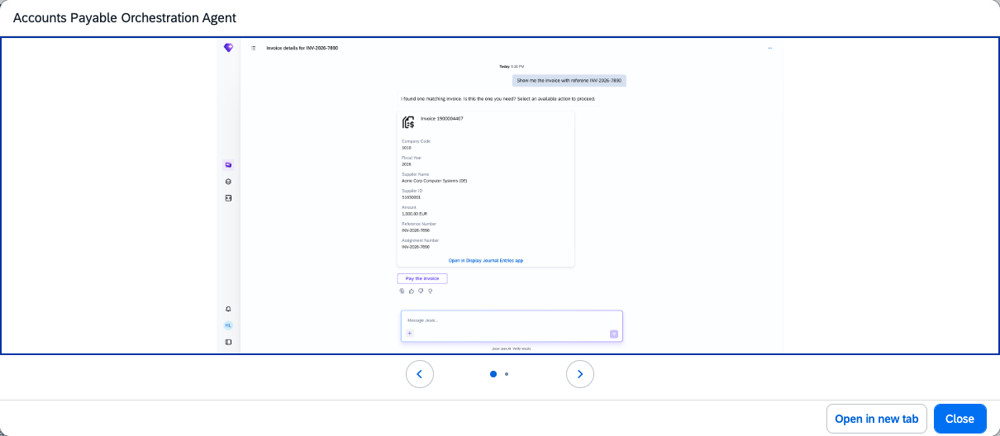

## Accounts Payable Orchestration Agent

### Objective

Coordinates the specialised agents within the Accounts Payable Assistant to automate AP workflows and streamline payment exception resolution. Routes user requests to the appropriate agent based on the nature of the task.

### Prerequisites

- At least one specialised agent (Receivables & Payables Clearing Agent) configured
- Scope item J60 (Accounts Payable) activated

### What It Can Do

- Route natural language AP requests to the correct specialised agent
- Automate AP workflows including invoice status checks and payment processing
- Resolve payment exceptions and flag issues for human review
- Provide real-time cash flow insights from AP data
- Clear payables and receivables through coordinated agent actions

### Example Prompts

| Prompt |
|--------|
| "@Accounts Payable Assistant, what is the status of invoice 5100012345?" |
| "@Accounts Payable Assistant, generate clearing proposals for open items on vendor account V-1000" |
| "@Accounts Payable Assistant, process an ad hoc payment for invoice 5100012345 in company code 1010" |

  

*Figure – Accounts Payable Orchestration Agent in action (Source: SAP Discovery Center)*
