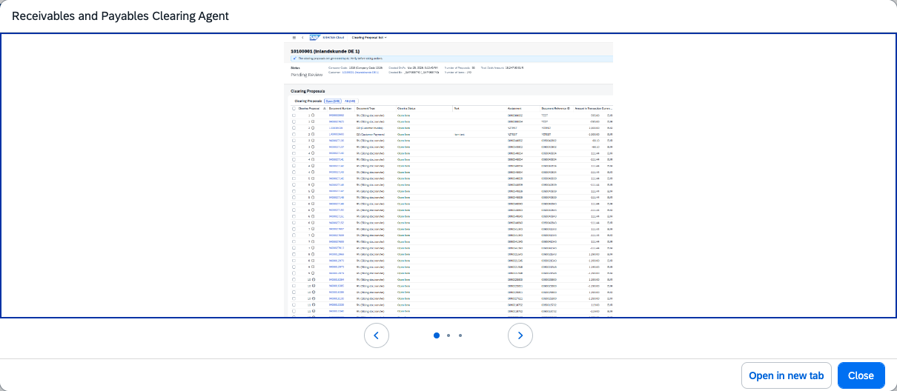

## Receivables and Payables Clearing Agent

### Objective

Generates balanced clearing proposals for AP and AR open items. Uses AI-based matching analysis to create system-validated proposals for accountant review, reducing manual effort and improving clearing accuracy.

### Prerequisites

- Scope items J59 (Accounts Receivable) and J60 (Accounts Payable) activated
- Fiori apps assigned: Manage Supplier Clearing Proposals (F9300) and Manage Customer Clearing Proposals (F9287)
- SAP Note 3767703 implemented (Private Edition)

### What It Can Do

- Generate AI-based matching proposals for open payables and receivables
- Analyse aging patterns to identify optimal matching combinations
- Create balanced, system-validated clearing proposals
- Integrate with dedicated SAP Fiori applications for review and posting
- Reduce manual matching effort and human error in the clearing process

### Example Prompts

| Prompt |
|--------|
| "Generate clearing proposals for open AP items on vendor account V-1000 in company code 1010" |
| "Match outstanding invoices with available credit notes for vendor V-2000" |
| "Show me all uncleared open items for vendor V-1000 and propose a clearing document" |

  

*Figure – Receivables and Payables Clearing Agent in action (Source: SAP Discovery Center)*
