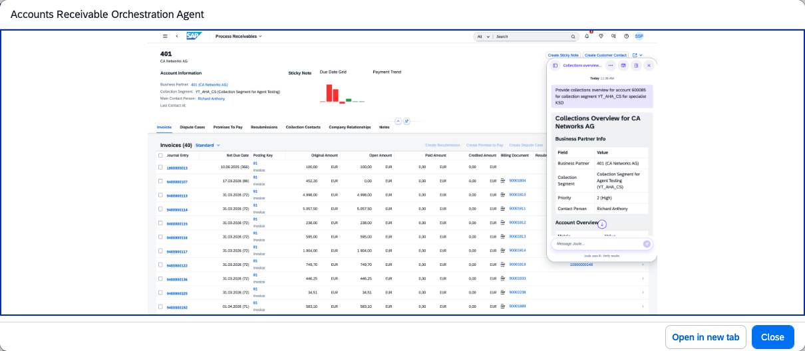

## Accounts Receivable Orchestration Agent

### Objective

Coordinates the specialised agents within the Accounts Receivable Assistant. Routes collection, dispute, clearing, and dunning requests to the appropriate agent based on the nature of each task.

### Prerequisites

- Business role `SAP_BR_AR_ACCOUNTANT` assigned
- SAP Dispute Management (FIN-FSCM-DM) and Collections Management (FIN-FSCM-COL) active

### What It Can Do

- Route natural language AR requests to the correct specialised agent
- Accelerate cash collection through AI-driven insights and next-best-action recommendations
- Provide a consolidated view of overdue items, balances, disputes, and contact history
- Coordinate dispute resolution and dunning activities across agents
- Reduce manual AR activities and Days Sales Outstanding (DSO)

### Example Prompts

| Prompt |
|--------|
| "@Accounts Receivable Assistant, show me the top 10 overdue accounts by balance for company code 1010" |
| "@Accounts Receivable Assistant, prepare the collection dossier for customer C-10001" |
| "@Accounts Receivable Assistant, what disputes are open for customer C-10001 and what is the recommended next step?" |

  

*Figure – Accounts Receivable Orchestration Agent in action (Source: SAP Discovery Center)*
