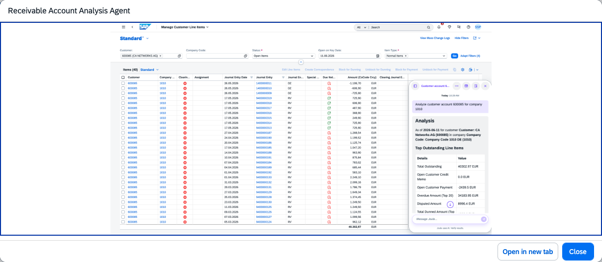

## Receivable Account Analysis Agent

### Objective

Provides a comprehensive overview and insights into a customer account. Consolidates overdue balances, payment behaviour, aging information, dispute linkages, and clearing-related insights to support collection decision-making.

### Prerequisites

- Fiori apps assigned to user: F1741, F1739, F0703A, F2328, F0711, F0702A

### What It Can Do

- Display consolidated customer account overview including overdue items and balances
- Analyse payment trends and customer payment behaviour
- Show aging analysis and days overdue by invoice
- Link disputes to open items for a complete picture
- Identify uncleared open payments and clearing opportunities

### Example Prompts

| Prompt |
|--------|
| "Show me the full account overview for customer C-10001 including overdue items and payment trends" |
| "What is the aging breakdown for customer C-10001 in company code 1010?" |
| "Identify the top 5 customers by overdue balance in credit segment CS-001" |

  

*Figure – Receivable Account Analysis Agent in action (Source: SAP Discovery Center)*
