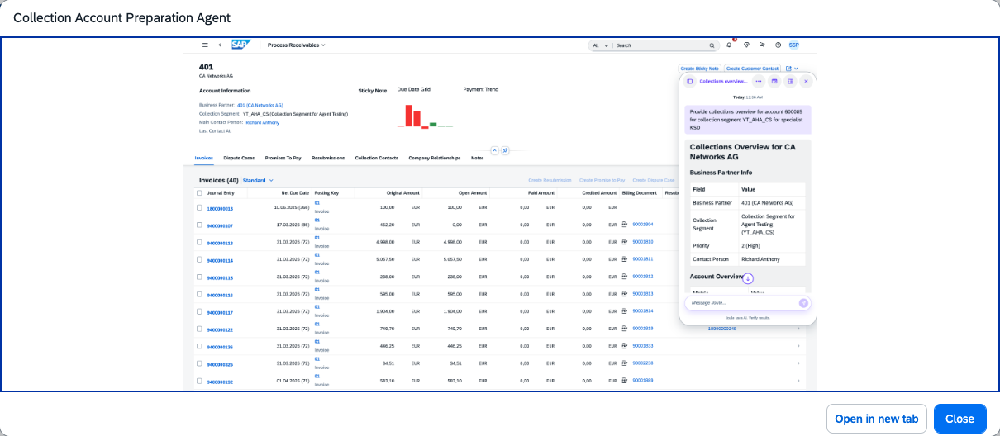

## Collection Account Preparation Agent

### Objective

Streamlines the collection process by consolidating account data and providing real-time insights and actionable recommendations for collection specialists, reducing the manual effort of preparing for collection calls.

### Prerequisites

- Business role `SAP_BR_AR_ACCOUNTANT` assigned

### What It Can Do

- Consolidate all relevant account data for collection preparation
- Provide real-time insights on customer payment behaviour and risk
- Generate next-best-action recommendations for the collection specialist
- Summarise prior collection activities and interaction history
- Identify the most effective collection strategy for each account

### Example Prompts

| Prompt |
|--------|
| "Prepare the collection dossier for my call with customer C-10001" |
| "What is the recommended collection approach for customer C-10001 based on their payment history?" |
| "Show me all overdue accounts in my worklist with collection recommendations" |

  

*Figure – Collection Account Preparation Agent in action (Source: SAP Discovery Center)*
