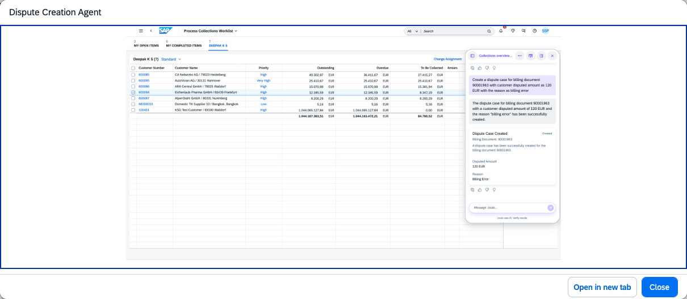

## Dispute Creation Agent

### Objective

Manages the lifecycle of dispute cases using natural language processing. Enables creation of dispute cases by processing unstructured data such as user prompts or email content, and provides insights over open disputes.

### Prerequisites

- Scope item BFC (Collection and Dispute Management) activated
- Business role `SAP_BR_AR_ACCOUNTANT` assigned
- Fiori apps assigned: Manage Dispute Cases (F0702A), Process Receivables (F0106A)

### What It Can Do

- Process unstructured data such as user prompts or email content to create dispute cases
- Validate the existence of related billing documents before creating a dispute
- Detect duplicate dispute cases to prevent redundant entries
- Create dispute cases automatically with the correct classification
- Provide an overview of open disputes for a customer account

### Example Prompts

| Prompt |
|--------|
| "Create a dispute case for customer C-10001 regarding invoice 9000123456 — the quantity delivered was incorrect" |
| "Open a dispute for the pricing discrepancy on invoice 9000123457 for customer C-10002" |
| "Show me all open dispute cases for customer C-10001" |

  

*Figure – Dispute Creation Agent in action (Source: SAP Discovery Center)*
