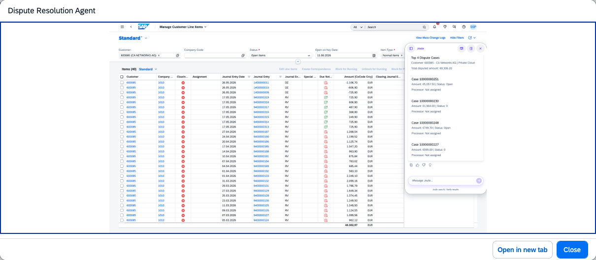

## Dispute Resolution Agent

### Objective

Automates the validation of dispute cases and suggests actionable resolution steps. Reviews invoices, sales orders, delivery records, pricing agreements, and historical data to identify root causes and recommend compliant resolutions.

### Prerequisites

- Business role `SAP_BR_AR_ACCOUNTANT` assigned

### What It Can Do

- Validate dispute cases by cross-referencing invoices, orders, and delivery records
- Identify root causes of disputes using historical data and pricing agreements
- Propose compliant resolution steps with supporting rationale
- Reduce the time required to analyse and resolve dispute cases
- Maintain a complete audit trail of dispute validation and resolution actions

### Example Prompts

| Prompt |
|--------|
| "Validate dispute case DC-00123 and recommend a resolution" |
| "What is the root cause of the pricing dispute on invoice 9000123456?" |
| "Review dispute DC-00124 and propose a settlement option for customer approval" |

  

*Figure – Dispute Resolution Agent in action (Source: SAP Discovery Center)*
