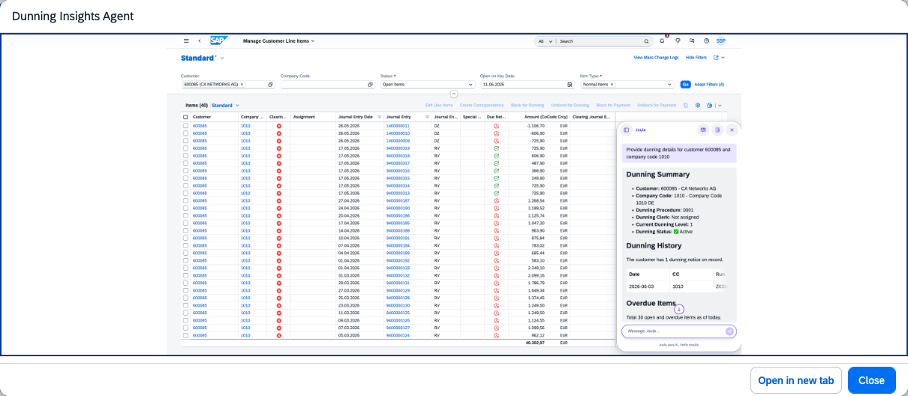

## Dunning Insights Agent

### Objective

Helps AR accountants accelerate collections with AI-driven dunning insights. Retrieves dunning history, identifies the current dunning level, analyses overdue line items, and recommends follow-up actions or dunning block changes based on payment patterns.

### Prerequisites

- Business role `SAP_BR_AR_ACCOUNTANT` assigned

### What It Can Do

- Retrieve dunning history and current dunning level for a customer
- Analyse overdue line items and their dunning status
- Recommend next dunning actions based on payment behaviour and history
- Suggest dunning block changes where appropriate
- Support proactive collection strategies to reduce DSO

### Example Prompts

| Prompt |
|--------|
| "Show me the dunning history and current level for customer C-10001" |
| "What is the recommended next dunning action for customer C-10002 given their payment pattern?" |
| "Are there any customers in my worklist where a dunning block should be removed?" |

  

*Figure – Dunning Insights Agent in action (Source: SAP Discovery Center)*
