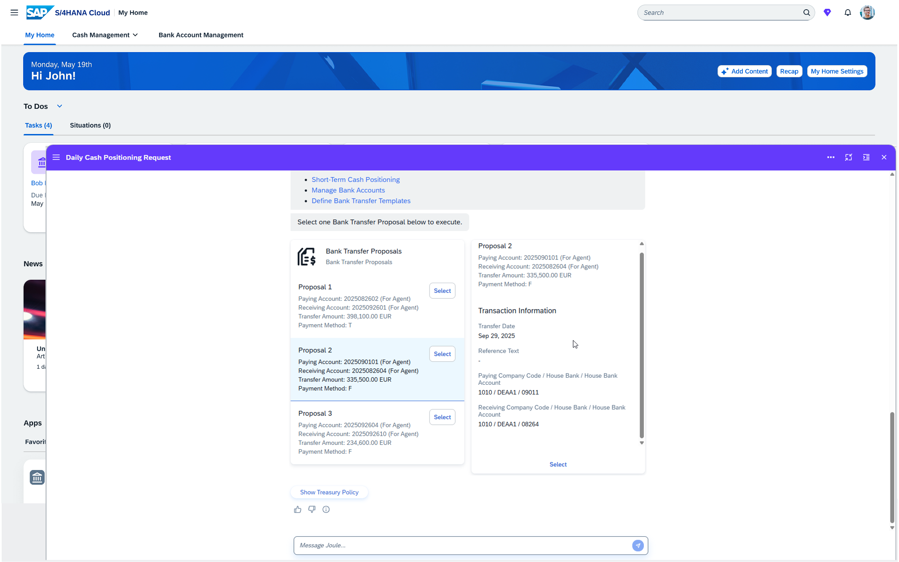

## Cash Positioning Agent

### Objective

Assists cash managers in managing daily cash positioning tasks such as checking the opening balances of bank accounts, forecasting today's cash flows, calculating the expected closing balances for bank accounts, and transferring funds with minimal manual effort. It highlights bank accounts that require attention and assists in making informed decisions to optimise cash distributions across bank accounts, minimise overdrafts, and enhance financial efficiency.

### Prerequisites (Private Edition)

- Business roles `SAP_BR_CASH_MANAGER` and `SAP_BR_CASH_SPECIALIST` assigned
- Minimum release: SAP S/4HANA 2023 FPS01
- APIs active: `UI_SHORTTERMCASHPOS_AI_C1_V4`, `FCLM_CASH_BANKTRANSFER_SRV_C1_V2`, `FCLM_CASH_BANKTRANSFERTEM_SRV_C1_V2`, `UI_CashPosition_AI_C1_V4`
- SAP Notes implemented: 3576432, 3616238, 3724030
- Treasury Policy defined; Cash Position Profile maintained; Bank Transfer Templates available

### What It Can Do

- **Daily Cash Positioning** — Automatically organises data by retrieving opening balances, forecasting cash flows, and calculating closing balances for bank accounts
- **Bank Account Insights** — Provides detailed views of bank accounts with surplus and deficits to help pinpoint areas requiring immediate action
- **Bank Transfer Proposals** — Suggests bank transfer options with bank transfer templates, allowing selection of the best solution for cash shortfalls
- **Bank Statement Monitoring** — Provides a consolidated summary of bank statement statuses, enabling efficient monitoring and quicker issue identification
- **Liquidity Optimisation** — Recommends optimal bank transfer proposals to efficiently manage available cash positions

### Treasury Policy

The treasury policy is a set of rules that guides the agent in performing daily cash positioning work. It is loaded automatically at the start of each session. Key fields:

| Field | Required | Example |
|-------|----------|---------|
| Cash Position Profile | Yes | CP01 |
| Bank Account Currency | Yes | EUR |
| Surplus Threshold | No | 1000 |
| Deficit Threshold | No | -500 |
| Company Code | No | 3010 |

To manage your treasury policy in Joule, use: `Upload treasury policy`, `Show treasury policy`, `Change treasury policy`, or `Delete treasury policy`.

### Example Prompts

| Prompt |
|--------|
| "Perform cash position daily work" |
| "Bank Statement Monitoring" |
| "Perform Cash Position Monitoring" |

### In Action

*Cash Positioning Agent — daily cash positioning with bank transfer proposals*

