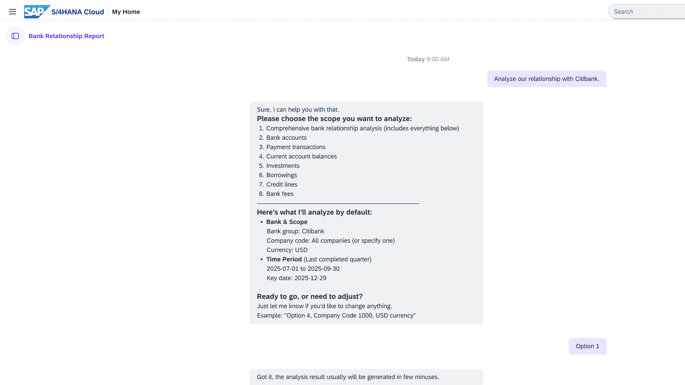
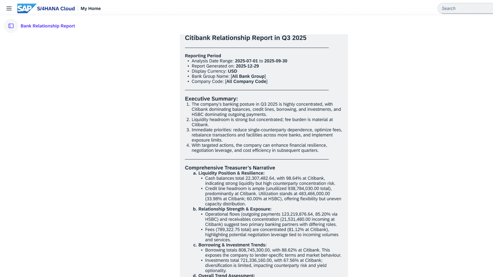

## Bank Relationship Agent

### Objective

Enables cash managers and treasurers to analyse bank relationships using natural language queries. Assists in making bank account management decisions based on insights from various perspectives — average bank account balances, payment volumes, credit lines, borrowings, investments, and bank fees.

### Prerequisites (Private Edition)

- Cash and Treasury Orchestration Agent activated and configured
- In Customizing activity **Define Basic Settings**, set **Full Scope** for the **Cash Scope** setting
- IAM app `F8926_TRAN` (Bank Relationship Management via API) assigned to user
- Bank hierarchy set up in Manage Bank Accounts – Bank Hierarchy View app (F1366)
- FI components active: Cash and Liquidity Management (FIN-FSCM-CLM), Treasury and Risk Management (FIN-FSCM-TRM), Bank Statements (FI-BL-PT-BA)

> When no display currency or time period is specified, the agent defaults to USD and the last completed quarter.

### What It Can Do

- Analyse bank accounts, balances, payment volumes, credit lines, borrowings, investments, and bank fees
- Automatically fetch data from multiple sources and structure it into tables and rankings
- Perform comparisons across bank groups and time periods
- Generate insights and highlight potential risks
- Support banking strategy decisions through natural language conversations

### Example Prompts

| Prompt |
|--------|
| "Bank relationship analysis" |
| "What's our relationship with Bank ABC?" |
| "Which banks are we working with in Europe?" |
| "Show me the average bank account balance by bank group for Q4 2025 in USD." |
| "Analyse payment transactions with Bank Group ABC for Q1 2026." |
| "What are our biggest payments this month?" |
| "Which banks are we paying the most fees to?" |
| "Analyse bank fees in Germany for 2025." |
| "Do we have enough credit available?" |
| "What are my current investments and borrowings?" |

### In Action

*Bank Relationship Agent — scope selection for Citibank analysis*

*Citibank Relationship Report — Q3 2025 executive summary and treasurer's narrative*

