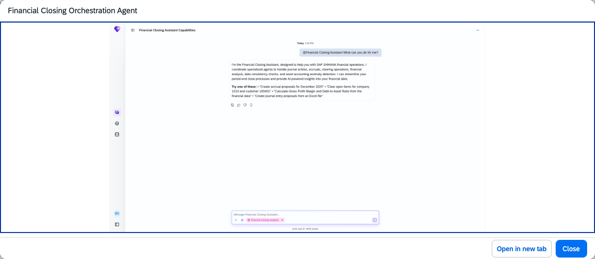

## Financial Closing Orchestration Agent

### Objective

Coordinates the specialised agents within the Financial Closing Assistant to execute financial closing workflows. It breaks complex close tasks into manageable steps, manages dependencies between agents, and provides transparent monitoring of all agentic and non-agentic activities.

### What It Can Do

- Orchestrate end-to-end financial closing workflows across multiple specialised agents
- Manage sequencing and dependencies between journal entry, accrual, clearing, and analysis activities
- Provide real-time visibility into close task status and progress
- Balance workload dynamically across finance teams and agents
- Produce audit-ready documentation of all close activities

### Example Prompts

| Prompt |
|--------|
| "@Financial Closing Assistant, what is the current status of all open closing tasks?" |
| "@Financial Closing Assistant, identify and flag any inconsistencies blocking this month-end close" |
| "@Financial Closing Assistant, execute the standard period-end workflow for company code 1010" |

  

*Figure – Financial Closing Orchestration Agent in action (Source: SAP Discovery Center)*
