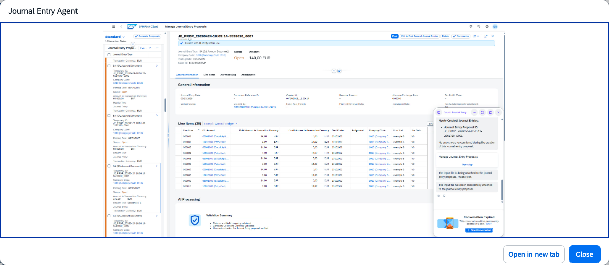

## Journal Entry Agent

### Objective

Saves time and delivers audit-ready precision across journal entry activities. Automates data conversion and enforces upfront validation against posting rules, allowing accountants to identify and resolve issues early before posting.

### Prerequisites

- Scope item J58 (Accounting and Financial Close) activated
- Business catalogue `SAP_SFIN_BC_GL_JE_PROC` with company-code authorisation (BUKRS) assigned
- Fiori app Manage Journal Entry Proposals (F9263) assigned to user

### What It Can Do

- Convert raw finance files into upload-ready journal entry proposals
- Validate mandatory fields, account assignments, and posting rules upfront
- Detect anomalies using historical posting patterns
- Generate audit-ready documentation automatically
- Enforce compliance with organisational posting guidelines

### Example Prompts

| Prompt |
|--------|
| "Convert this spreadsheet into journal entry proposals and validate against our posting rules" |
| "Review these journal entries for missing master data and flag any anomalies" |
| "Which journal entries in this batch deviate from our historical posting patterns?" |

  

*Figure – Journal Entry Agent in action (Source: SAP Discovery Center)*
