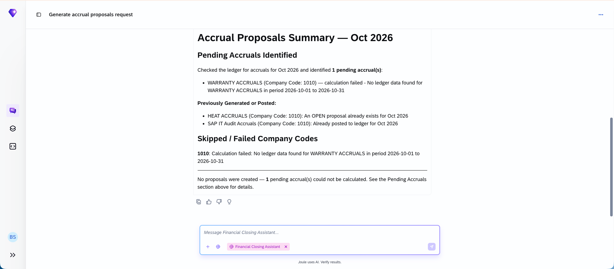

## Accounting Accruals Agent

### Objective

Automates journal entry preparation for manual accruals by analysing historical financial data and accounting policy documents to generate pre-populated journal entry proposals for accountant review and approval.

### Prerequisites

- Scope item J58 (Accounting and Financial Close) activated
- Business catalogue `SAP_SFIN_BC_GL_JE_PROC` with company-code authorisation (BUKRS) assigned
- Accounting Policy Handbook prepared with company-specific accrual rules

### What It Can Do

- Analyse historical financial data and patterns to calculate accrual and deferral amounts
- Interpret accounting policy documents to apply company-specific rules
- Generate pre-populated journal entry proposals for period-end accruals
- Reduce manual calculation errors during period-end close
- Accelerate the accrual preparation step of the close process

### Example Prompts

| Prompt |
|--------|
| "Generate accrual proposals for this quarter based on our accounting policies and historical data" |
| "Review this accrual calculation against our policy document and flag any deviations" |
| "Prepare journal entries for all pending accruals and deferrals for company code 1010" |

  

*Figure – Accounting Accruals Agent in action (Source: SAP Discovery Center)*
