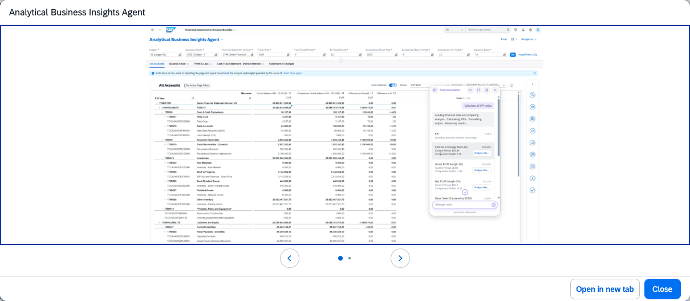

## Analytical Business Insights Agent

### Objective

Analyses financial KPIs to deliver actionable insights via guided workflows. Enables end-to-end financial KPI analysis, variance root-cause identification, and guided workflow-driven recommendations to reduce time spent on manual data investigation.

### What It Can Do

- Analyse financial KPIs and identify material variances
- Perform root-cause analysis on variance drivers across dimensions
- Deliver actionable insights and guided next-step recommendations
- Reduce time spent on manual data investigation and number-crunching
- Improve decision efficiency and overall business performance analysis

### Example Prompts

| Prompt |
|--------|
| "Analyse the variance in cost of goods sold for Q3 versus Q2 and identify the top drivers" |
| "What are the main contributors to the revenue shortfall in region EMEA this period?" |
| "Generate a financial KPI summary with variance commentary for the CFO review" |

  

*Figure – Analytical Business Insights Agent in action (Source: SAP Discovery Center)*
