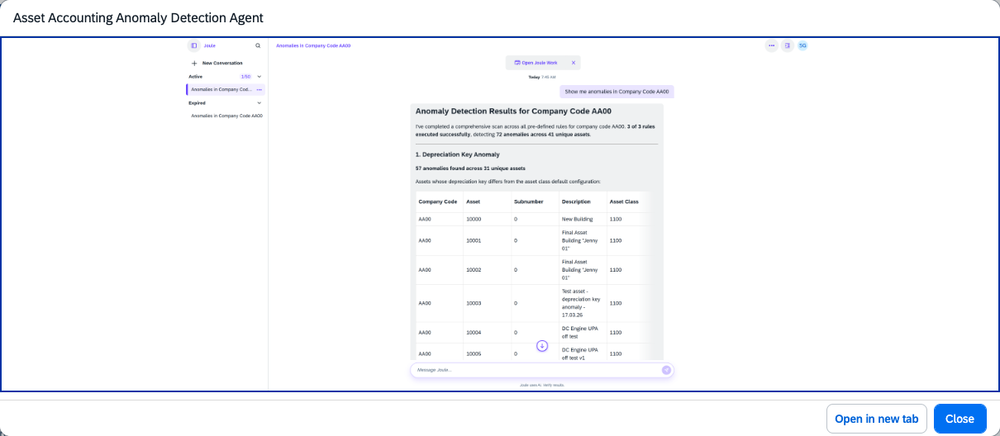

## Asset Accounting Anomaly Detection Agent

### Objective

Improves audit readiness by preventing inaccurate or invalid asset postings. Detects anomalies in asset accounting transactions before they are posted, reducing the risk of incorrect asset valuations and simplifying period-end reconciliation.

### What It Can Do

- Detect anomalies and irregularities in asset accounting transactions before posting
- Flag potentially invalid or inaccurate asset postings for review
- Reduce the risk of incorrect asset valuations entering the ledger
- Support audit readiness by maintaining clean asset accounting records
- Simplify period-end reconciliation by preventing upstream errors

### Example Prompts

| Prompt |
|--------|
| "Scan pending asset postings in company code 1010 and flag any anomalies" |
| "Are there any unusual asset transactions in the current period that require review?" |
| "Identify asset postings that deviate from our standard capitalisation rules" |

  

*Figure – Asset Accounting Anomaly Detection Agent in action (Source: SAP Discovery Center)*
