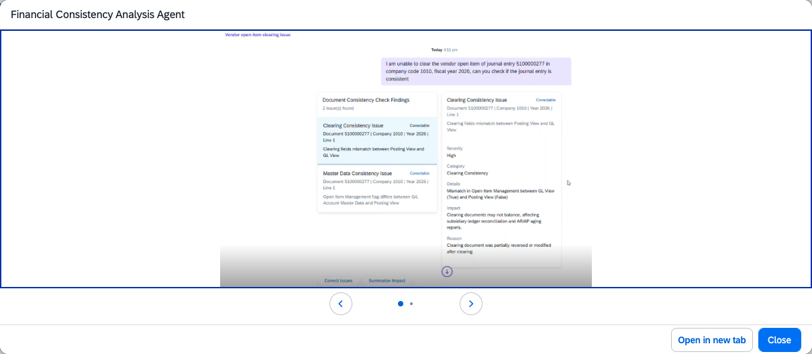

## Financial Consistency Analysis Agent

### Objective

Reveals hidden process inconsistencies and resolves data errors that can block critical financial processes. Proactively detects discrepancies between ledgers and missing master data, and recommends corrective actions.

### Prerequisites

- Minimum release: SAP S/4HANA Cloud Private Edition 2025 FPS01

### What It Can Do

- Detect data inconsistencies between the general ledger and sub-ledgers
- Identify missing or invalid master data that could block close activities
- Explain the root cause and business impact of each detected issue
- Recommend and apply corrective actions
- Prevent delays in payment runs, clearing, and FX valuation

### Example Prompts

| Prompt |
|--------|
| "Scan the GL and AR sub-ledger for consistency discrepancies in company code 1010" |
| "Are there any master data issues that could block the upcoming payment run?" |
| "Identify and recommend fixes for any FX valuation discrepancies this period" |

  

*Figure – Financial Consistency Analysis Agent in action (Source: SAP Discovery Center)*
