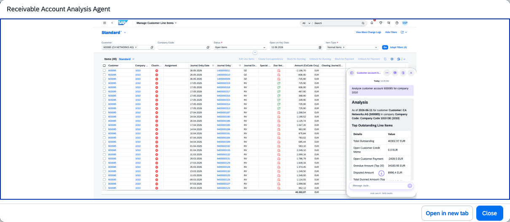

## Receivable Account Analysis Agent

### Objective

Provides an in-depth overview of a customer's receivable health, retrieving and correlating data across invoices, disputes, and credit memos to deliver comprehensive receivables insights. The agent helps AR accountants prioritize accounts and take the right actions faster without navigating multiple apps.

### What It Can Do

- Retrieve receivables data from invoices, disputes, and credit memos to build complete customer receivables profiles
- Deliver in-depth insights across multiple dimensions such as aging, days sales outstanding, and payment behavior
- Provide data-driven suggestions for next steps in the collections and receivables management process
- Retain customer context across follow-up questions within the same conversation

### Example Prompts

| Prompt |
|--------|
| "Provide overview for customer account 30424 and company code 0001" |
| "Show aging bucket overview for customer 30424" |
| "List the invoices in the overdue bucket 1 to 30 days for customer 30424" |
| "What are the top 5 disputes for customer 30424?" |
| "Show my open disputes" |

