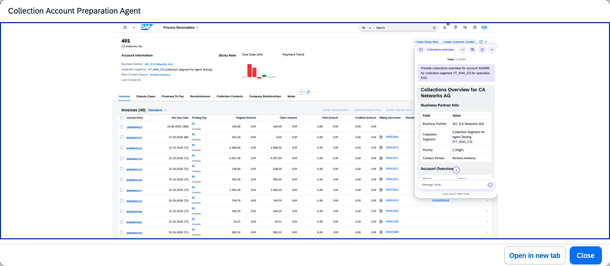

## Collection Account Preparation Agent

### Objective

Automates the consolidation and analysis of collection account data to provide comprehensive customer insights for collection specialists. The agent retrieves and analyses collection account data, then generates AI-powered actionable recommendations to streamline collection activities — eliminating the need to navigate multiple applications before customer outreach.

### What It Can Do

- Retrieve business partner information, collection segment, priority, and contact persons
- Provide account overview: outstanding amounts, overdue amounts, amount to be collected, and promised payments
- Deliver insights: collection risk level, open promises due, unreached calls, and missing or available contacts
- Generate recommended actions: maintain contact details, monitor due payments, retry customer contacts, track ageing buckets
- Support conversational follow-ups without switching between transactions

### Example Prompts

| Prompt |
|--------|
| "Display worklist for collection specialist [name]" |
| "Select customer from worklist to retrieve the collection overview" |
| "Display aging bucket overview for business partner 411" |
| "List the invoices in the overdue bucket 1 to 30 days for business partner 411" |
| "Present the contact history for business partner 411 and pending tasks overview" |
| "Provide collection overview for customer 30424 and collection segment SCG1" |

