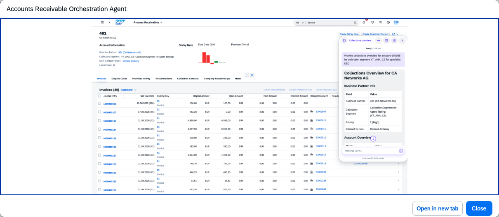
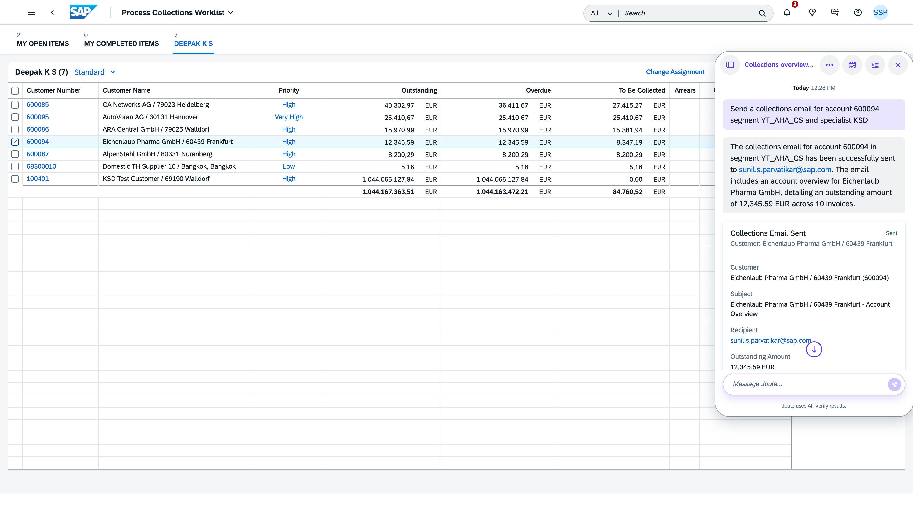

## Collections Email Outreach Agent

**Identifier:** J1574 | [Discovery Center](https://discovery-center.cloud.sap/protected/index.html#/ai-agent/3619ad5a-e83e-40a4-990a-cb91beb52d92/) | **Minimum Version:** SAP S/4HANA 2025 FPS01

### Objective

Automates email communication with customers who have outstanding invoices. The agent generates personalised collections emails with customer insights, sends the emails to customer contact persons in their preferred language maintained in the master data, and logs all outreach activities — significantly reducing manual effort for collection specialists.

### What It Can Do

- Generate personalised collections emails incorporating open invoices, disputes, and broken promises to pay
- Send emails to the customer contact's email address maintained in master data, in the customer's preferred language
- Automatically create a customer contact activity in **Manage Customer Contacts** and log the email content in **Manage Collection Emails** for future reference
- Ask for user confirmation before executing any write action (sending the email or creating the contact activity)

> Before using this agent, upload a policy document containing the Contact Type and Result of Activity specifications through Joule.

### Example Prompts

| Prompt |
|--------|
| "Upload the policy document for the Collections Email Outreach Agent" |
| "Send collections email for customer CUST1 and collection segment CUST_SEG1" |
| "Send a collections follow-up to customer 30424 for collection segment SCG1" |

## Screenshots

