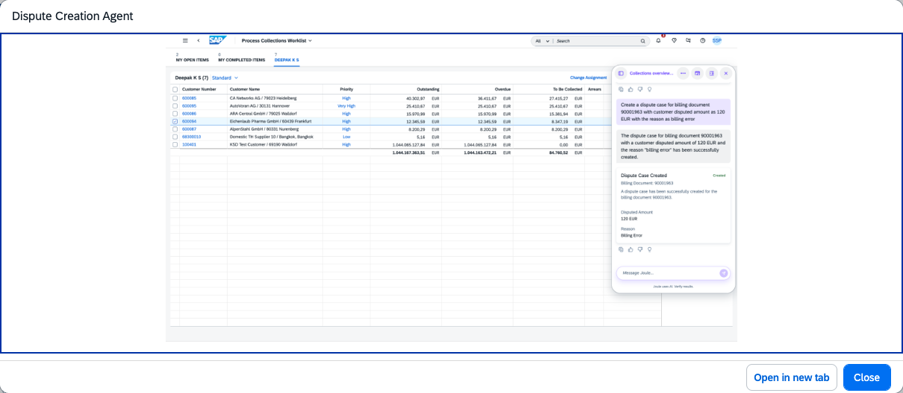

## Dispute Creation Agent

### Objective

Empowers collection specialists and AR accountants to create and manage disputes more efficiently. The agent processes unstructured inputs such as user prompts and email content, extracts relevant information from associated billing documents, and automates routine dispute creation tasks — reducing manual effort and improving accuracy.

### What It Can Do

- Create dispute cases from billing document IDs and unstructured issue descriptions
- Validate the existence of the billing document and check whether an associated dispute case already exists
- Update existing dispute case attributes or create new disputes as required
- Retrieve dispute attributes for a given dispute case for quick reference
- Enable users to add notes to a dispute case

> **Note:** Additional authorization is required for related objects such as Billing Documents, beyond the standard AR Accountant role.

### Example Prompts

| Prompt |
|--------|
| "Create Dispute Case for Billing Document 90001234 related to price differences for an amount of 50 EUR" |
| "Show me dispute case 2923" |
| "Get notes for dispute 50012345" |
| "Show disputes requiring customer action for customer 10001234" |

