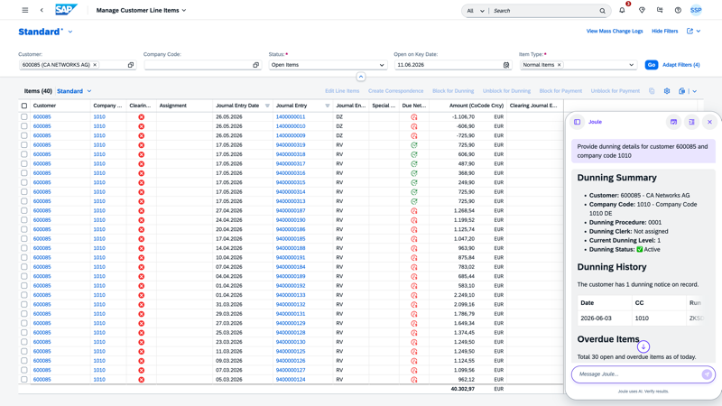

## Dunning Insights Agent

**Identifier:** J1573 | [Discovery Center](https://discovery-center.cloud.sap/protected/index.html#/ai-agent/c4987a97-67ea-445e-a198-e13eb3079b3b/) | **Minimum Version:** SAP S/4HANA 2025 FPS01

### Objective

Helps AR accountants accelerate collections with AI-driven dunning insights. The agent retrieves dunning history, identifies the current dunning level based on configured procedures, analyses dunning notices and overdue line items, and provides actionable recommendations — including inline actions to set or remove dunning blocks directly from the conversation.

### What It Can Do

- Retrieve consolidated dunning history, overdue amounts, items by dunning level, and notice dates for a customer
- Identify active dunning blocks and surface risk signals
- Provide data-driven next-best action recommendations
- Set or remove dunning blocks on specific line items directly from the conversation (with confirmation required)
- Retain customer context across follow-up questions

### Example Prompts

| Prompt |
|--------|
| "Analyze dunning for customer 30424 in company code 0001" |
| "Show me line items of the dunning notice for customer 30424" |
| "Remove dunning block for item 0001 in document 100138671 fiscal year 2026, company code 0001" |
| "Set dunning block for item 001 in document 100138671 fiscal year 2026, company code 0001" |

## Screenshots

