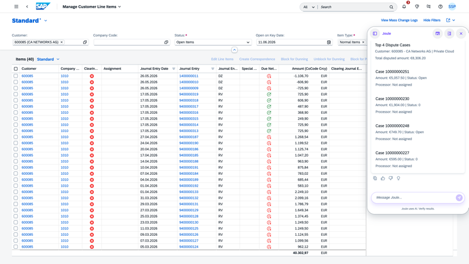

## Dispute Resolution Agent

**Identifier:** J1570 | [Discovery Center](https://discovery-center.cloud.sap/protected/index.html#/ai-agent/bb17e6c0-83df-4aa3-b43c-8c0a1f18189f/) | **Minimum Version:** SAP S/4HANA 2023 FPS01

### Objective

Helps AR accountants resolve disputes more efficiently by automatically retrieving comprehensive dispute data, validating dispute reasons against related business documents (invoices, sales orders, delivery records, pricing agreements, tax rules), and providing detailed analysis with tailored recommendations for resolution.

### What It Can Do

- Retrieve comprehensive dispute data including disputed receivable items, business partner information, dispute reason codes, and communication history
- Validate dispute claims against related business documents
- Provide detailed analysis with actionable recommendations for dispute resolution
- Support inline actions: add internal notes to a dispute case, and upload or update the dispute resolution policy document
- Route disputes to the appropriate resolution path (Invoicing, Payment-Receipt, Logistics, Sales, or Others) based on an uploaded policy document

> Before analysing or resolving disputes, upload a policy document specifying Case Type, Reason Code, Reason, and Agent Resolution Path through Joule.
> **Note:** The agent cannot read information from dispute attachments. Custom or non-standard reason codes must be added to the policy document to ensure correct classification.

### Example Prompts

| Prompt |
|--------|
| "Upload dispute resolution policy document" |
| "Analyze dispute 50012345 for customer 2092 in company code 1710 and suggest next steps." |
| "Show me dispute case 2923" |
| "What are the top 5 disputes for customer 30424?" |
| "Show my open disputes" |
| "Show disputes requiring customer action for customer 10001234" |
| "Evaluate dispute 2920 for customer 2092 in company code 1710" |
| "Create note for dispute resolution" |

## Screenshots

