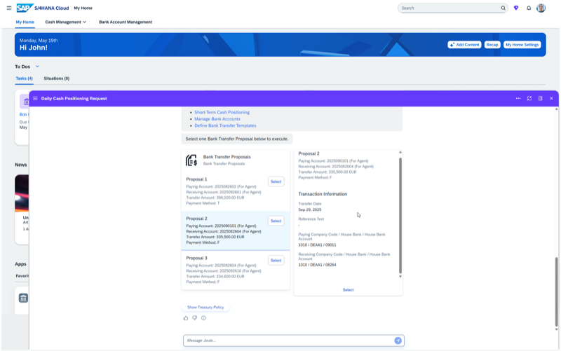

## Cash Positioning Agent

**Identifier:** J425 | [Discovery Center](https://discovery-center.cloud.sap/protected/index.html#/ai-agent/61f9300e-11e0-4ca2-acee-ace35c44fae0/)

### Objective

Provides visibility into cash positions across bank accounts and supports daily liquidity management activities. The agent helps treasury teams monitor inflows and outflows, review current bank balances, and take informed cash management decisions directly through Joule.

### What It Can Do

- Retrieve current cash position across bank accounts and company codes
- Display daily cash inflows and outflows
- Support liquidity planning by providing an overview of expected receipts and payments
- Help identify cash surpluses or shortfalls across accounts
- Propose bank transfers to resolve cash shortfalls using bank transfer templates

### Prerequisites

In your SAP S/4HANA Cloud Private Edition system:

- Business roles **SAP_BR_CASH_MANAGER** and **SAP_BR_CASH_SPECIALIST** are assigned.
- The following APIs are available:

  | API | Semantic Object-Action |
  |-----|------------------------|
  | UI_SHORTTERMCASHPOS_AI_C1_V4 | BankStatement-Monitor |
  | FCLM_CASH_BANKTRANSFER_SRV_C1_V2 | BankAccount-displayShortTermCashPosition |
  | FCLM_CASH_BANKTRANSFERTEM_SRV_C1_V2 | BankAccount-manageMasterData |
  | UI_CashPosition_AI_C1_V4 | BankAccount-transferWithTemplate / MemoRecord-manageV2 |

  Technical Catalog for Semantic Object-Action: **SAP_TC_FIN_CM_COMMON**, **SAP_TC_FIN_FO_COMMON**

- Implement SAP Notes: **3576432** (OData API development changes), **3616238** (backend for Bank Transfer scenario), **3724030** (backend for Bank Transfer scenario).
- Treasury Policy, Short Term Cash Positioning app, Cash Position Profile, and Bank Transfer Templates are configured.
- In the configuration activity **Define Basic Settings**, **Full Scope** is set for the **Cash Scope** setting.

### Data Sources

The agent retrieves data from the following components:

- Cash and Liquidity Management (FIN-FSCM-CLM)
- Treasury and Risk Management (FIN-FSCM-TRM)
- Bank Statements (FI-BL-PT-BA)

### Example Prompts

| Prompt |
|--------|
| "Show me the cash position for company code 1000." |
| "What is the current balance for bank account [account ID]?" |
| "Show me today's cash inflows and outflows for company code 1000." |
| "What is the expected cash position for the next 7 days?" |

## Screenshots

