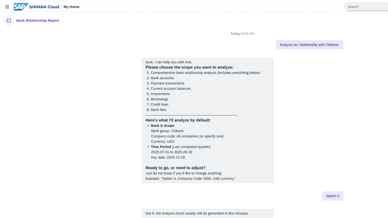
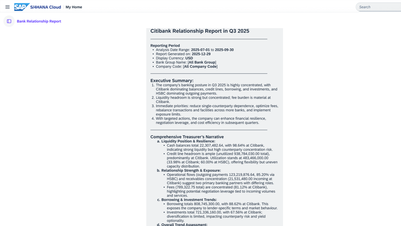

## Bank Relationship Agent

**Identifier:** J2203 | [Discovery Center](https://discovery-center.cloud.sap/protected/index.html#/ai-agent/fe3bb8b4-f521-4245-b664-ead7b2ba97cb/) | **Minimum Version:** SAP S/4HANA 2025 FPS02

### Objective

Manages bank account master data and supports bank relationship activities through natural language interactions in Joule. The agent helps treasury teams retrieve bank account information, review bank master data, and support ongoing bank relationship management without navigating multiple transactions.

### What It Can Do

- Retrieve bank account master data and account details
- Display bank account status and related attributes
- Support bank relationship management activities
- Help identify and review bank account information across company codes
- Analyze bank relationships, payment volumes, credit lines, borrowings, investments, and bank fees

### Prerequisites

In your SAP S/4HANA Cloud Private Edition system:

- In the Customizing activity **Define Basic Settings**, **Full Scope** is set for the **Cash Scope** setting.
- IAM app **F8926_TRAN** (Bank Relationship Management via API) is assigned to your user.
- Implement SAP Notes: **3744036** (Bank Relationship Agent - Cash & Treasury Assistant - PuC), **3798283** (Bank Relationship Agent - Cash & Treasury Assistant - PuC).
- The bank hierarchy is set up in the **Manage Bank Accounts - Bank Hierarchy View** app (F1366). Top-level nodes are used as bank groups in bank relationship analysis.

### Data Sources

The agent retrieves data from the following components:

- Cash and Liquidity Management (FIN-FSCM-CLM)
- Treasury and Risk Management (FIN-FSCM-TRM)
- Bank Statements (FI-BL-PT-BA)

### Example Prompts

| Prompt |
|--------|
| "Show me the bank accounts for company code 1000." |
| "What is the status of bank account [account ID]?" |
| "Display bank master data for bank [bank key]." |
| "List all active bank accounts for company code 1000." |

## Screenshots

