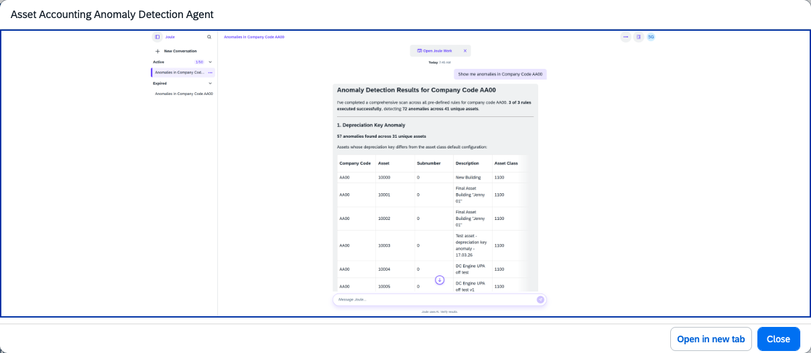

## Asset Accounting Anomaly Detection Agent

> Available on SAP S/4HANA Cloud Private Edition only.

### Objective

Detects data anomalies and inconsistencies in Fixed Asset Accounting (FI-AA) data before period-end close or depreciation runs. The agent helps asset accountants verify the quality and consistency of asset master data, identifies issues caused by incorrect field assignments, and supports natural language queries on basic asset master data.

### What It Can Do

- **Depreciation Key Mismatch** — Verifies whether the depreciation key on an asset master record for the current time segment matches the default depreciation key defined in the asset class
- **Negative Net Book Value** — Identifies assets with a negative net book value (NBV), which is not permitted under IFRS and most local legal standards
- **Deactivated Main Asset with Active Sub-Asset** — Detects sub-assets that remain active after the corresponding main asset has been deactivated
- Answer natural language queries about asset master data — for example, assets created within a certain time period that have not yet been capitalized

> The agent currently does not execute any changes automatically. All corrective actions must be performed manually. You must always specify at least one company code in your query.

### Example Prompts

| Prompt |
|--------|
| "Show me the assets which have a depreciation key mismatch in company code 1000." |
| "Show me the assets which have negative net book value in company code 1000 and fiscal year 2026." |
| "Show me the sub-assets that are still active, but their main asset has been deactivated in company code 1000." |
| "Show me the assets created in the past three months but still not yet capitalized in company code 1000." |
| "Show me the net book value of asset 100000 in company code 1000 for fiscal year 2025 period 016." |

> **Note:** For fiscal year variants with special periods (e.g., variant K4 with 12 posting periods and 4 special periods 13–16), specify the fiscal year and fiscal period directly in your query rather than using a calendar date.

