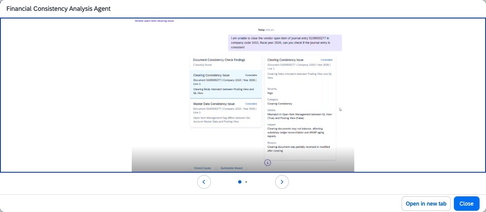

## Financial Consistency Analysis Agent

**Identifier:** J1479 | [Discovery Center](https://discovery-center.cloud.sap/protected/index.html#/ai-agent/a87b242f-ea9a-497a-93f5-83ad385b2dea/) | **Minimum Version:** SAP S/4HANA 2025 FPS01

> Available on SAP S/4HANA Cloud Private Edition only.

### Objective

Identifies and corrects data inconsistencies in journal entries and account master data that can prevent the completion of clearing processes and accurate financial reporting. The agent helps finance teams verify consistency before performing key activities such as period-end close, mass clearing, and payment runs.

### What It Can Do

- **Specific Journal Entry Based Analysis** — Check the consistency of specific journal entries in a company code and fiscal year
- **Mass Journal Entry Analysis** — Check the consistency of up to 4,000 journal entries online for a given company code, fiscal year, posting period, and account
- Check for consistency of Account master data and line items between Posting view and General Ledger view for the 'Is Open Item Managed' attribute
- Check the existence consistency of clearing fields between Posting view and General Ledger view
- Check the existence and consistency of Document Splitting data for a given journal entry
- Trigger correction of identified data inconsistencies

### Example Prompts

| Prompt |
|--------|
| "Check the consistency of journal entries posted in period 3 of fiscal year 2026 company code 1010" |
| "Check the consistency of journal entry '0123456789' in company code 1010, fiscal year 2026" |
| "Check the consistency of clearing information for journal entries posted in period 3 of fiscal year 20206 for account 113100 in company code 2026" |
| "Check the consistency of document splitting information for journal entries posted in period 3 of fiscal year 20206 for account 113100 in company code 2026" |
| "Check the consistency between master data and line items for journal entries posted in period 3 of fiscal year 20206 for account 113100 in company code 2026" |

