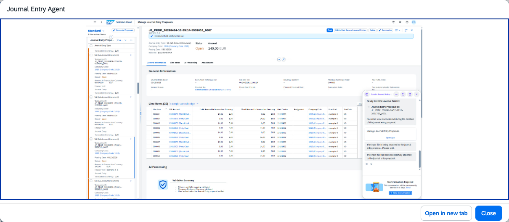

## Journal Entry Agent

**Identifier:** J1572 | [Discovery Center](https://discovery-center.cloud.sap/protected/index.html#/ai-agent/372b2954-5775-4cab-b2d0-84c34b240b9f/) | **Minimum Version:** SAP S/4HANA 2025 FPS02

### Objective

Automates and simplifies the creation of journal entries by replacing manual entry processes with intelligent proposals. The agent analyzes uploaded spreadsheet data alongside company policies, accounting rules, and historical postings to generate accurate and compliant journal entry proposals. Finance teams can review, adjust, and post these proposals directly in the **Manage Journal Entry Proposals** app.

### What It Can Do

- Accept spreadsheet-based input (Microsoft Excel `.xlsx` or `.csv`) containing journal entry data
- Automatically generate journal entry proposals based on the uploaded data — up to 999 proposals per uploaded file
- Scan the spreadsheet and propose a mapping between file columns and SAP journal entry fields (column names do not need to match SAP field names exactly)
- Perform validation checks and provide errors and warnings to support correct postings
- Support policy upload and enforcement per company code — validate proposals against permitted G/L Account and Cost Center or WBS Element combinations
- Identify opportunities for line item merging to reduce line count while preserving proposal structure
- Notify users when proposals have been successfully generated and are ready for review
- Deliver generated proposals for review, management, and posting in the **Manage Journal Entry Proposals** app

### Example Prompts

| Prompt |
|--------|
| "Create journal entry proposals from this spreadsheet." |
| "Upload a policy for company code 1010." |
| "Generate journal entry proposals for company code 1010." |
| "Is there an active policy for company code 1010?" |

> **Note:** To use the Journal Entry Agent, interact through the Joule chat window by submitting a request and uploading a data file. All proposals are created for review — no entries are posted automatically without user confirmation in the app.

