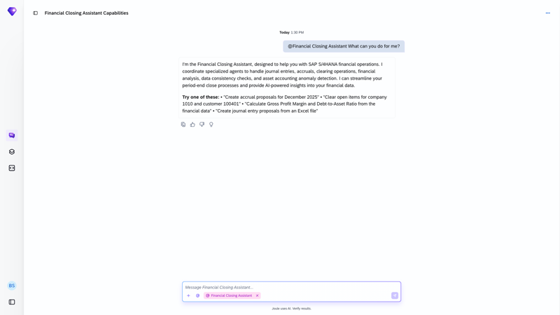

## Financial Closing Orchestration Agent

**Identifier:** J2207 | [Discovery Center](https://discovery-center.cloud.sap/protected/index.html#/ai-agent/680bff56-880b-4fde-9094-e329e75a30c9/)

### Objective

Coordinates the specialised agents within the Financial Closing Assistant. The orchestration agent receives user requests through Joule, determines which sub-agent is best suited to handle each task, and dispatches accordingly — covering journal entry processing, accrual preparation, analytical insights, asset accounting anomaly detection, financial consistency analysis, and clearing activities.

### What It Can Do

- Interpret natural language requests and route them to the appropriate Financial Closing sub-agent
- Coordinate multi-step closing tasks across the full period-end workflow
- Provide a single entry point for all Financial Closing Assistant interactions in Joule

### Sub-agents Coordinated

| Sub-agent | Responsibility |
|-----------|---------------|
| Accounting Accruals Agent | Automate journal entry preparation for manual accruals |
| Analytical Business Insights Agent | Analyse financial KPIs to deliver actionable insights |
| Asset Accounting Anomaly Detection Agent | Detect anomalies and inconsistencies in FI-AA data |
| Financial Consistency Analysis Agent | Identify and correct data inconsistencies preventing clearing |
| Journal Entry Agent | Automate journal entry creation from uploaded spreadsheet data |
| Receivables and Payables Clearing Agent | Generate clearing proposals for open receivable and payable items |

### Works With

- SAP S/4HANA Cloud Public Edition
- SAP S/4HANA Cloud Private Edition

### Example Prompts

| Prompt |
|--------|
| "Help me with financial closing." |
| "Create accrual proposals for company code [code]." |
| "What can the Financial Closing Assistant help me with?" |

> **Note:** The orchestration agent does not perform tasks directly. All closing actions are executed by the sub-agents it coordinates.

## Screenshots

