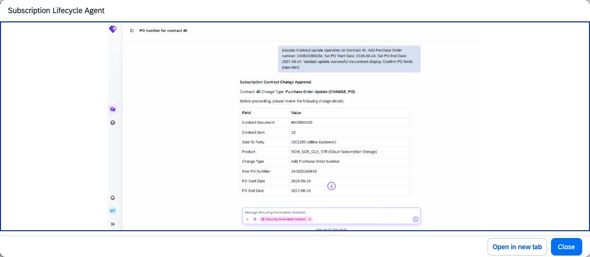

## Subscription Lifecycle Agent

### Objective

Manages subscription contract changes through natural language interactions in Joule. The agent handles common subscription lifecycle operations such as extending subscription durations, cancelling contracts, and updating purchase order references — enabling sales representatives to process subscription changes without navigating multiple transactions.

### What It Can Do

- Retrieve subscription contract details and current status
- Extend the duration of a subscription contract
- Cancel a subscription contract
- Update the purchase order (PO) reference on a subscription contract
- Guide users through mass processing of subscription contracts using the **Subscription Mass Processing** app

### Key APIs Consumed

| MCP | API |
|-----|-----|
| 25_1_API_SUBSCRIPTIONCONTRACT | API_SUBSCRIPTIONCONTRACT |
| 25_1_UI_SUBSCRPNMASSPROCG_MANAGE | UI_SUBSCRPNMASSPROCG_MANAGE |
| 25_1_SUBSCRPN_BILLINGCYCLEVH | APL_LOG_MANAGEMENT_SRV |

### Example Prompts

| Prompt |
|--------|
| "Show me subscription contract [contract ID]." |
| "Extend subscription contract [contract ID] by [duration]." |
| "Cancel subscription contract [contract ID]." |
| "Update the PO reference for subscription contract [contract ID] to [new PO number]." |

