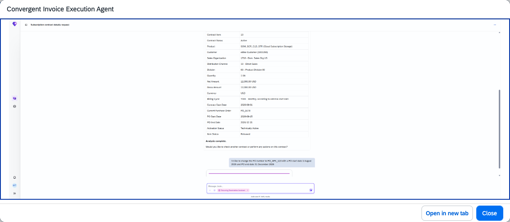

## Convergent Invoice Execution Agent

### Objective

Handles convergent invoicing document management and billing execution through natural language interactions in Joule. The agent enables invoicing specialists to retrieve, review, and manage convergent invoicing documents and billing requests without navigating multiple transactions.

### What It Can Do

- Retrieve and display convergent invoice documents
- Display billing requests and their status
- Support management of invoice adjustments and credit requests through the `API_CAINVOICEADJMTREQUEST` API

### Key APIs Consumed

| OData API | Purpose |
|-----------|---------|
| `O2C_CI_INVDOC_DISPLAY_SRV` | Display convergent invoice documents |
| `O2C_CI_INVREQ_DISPLAY_SRV` | Display invoice requests |
| `API_CAINVOICEADJMTREQUEST` | Manage invoice adjustment requests |

### Example Prompts

| Prompt |
|--------|
| "Show me invoice document [document ID]." |
| "Display billing requests for business partner [ID]." |
| "Show me the status of invoice request [ID]." |

> **Note:** For SAP S/4HANA Cloud Private Edition 2025 FPS01, implement SAP Note **3803943** before using this agent.

