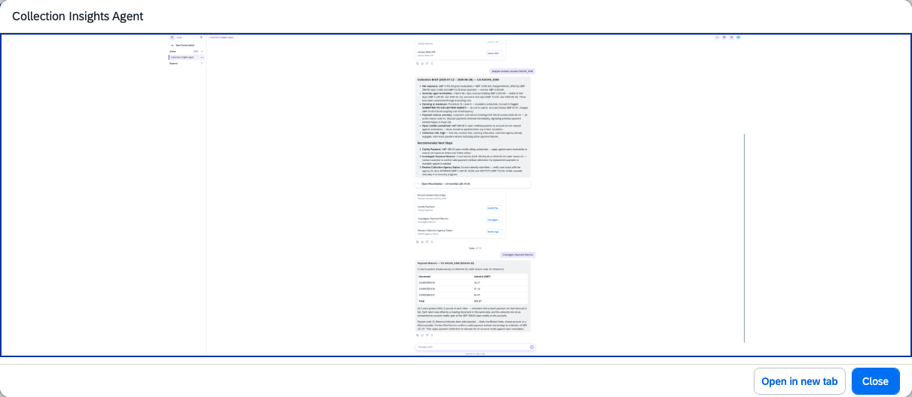

## Collection Insights Agent

**Identifier:** J1552 | [Discovery Center](https://discovery-center.cloud.sap/protected/index.html#/ai-agent/eb4dfc6b-02ff-45b6-9816-744972e35535/) | **Minimum Version:** SAP S/4HANA 2025 FPS01

### Objective

Provides collection insights and dunning analysis for contract accounting (FI-CA) customers. The agent helps FI-CA accountants review outstanding balances, analyse dunning history, manage dispute cases, and gain actionable insights into collection activities — all through natural language interactions in Joule.

### What It Can Do

- Retrieve FI-CA business partner balance and line item information
- Analyse dunning history and current dunning status for a contract account
- Display and manage FI-CA dispute cases
- Retrieve payment history and contract account details
- Access and review invoicing documents from convergent invoicing
- Display dunning notice history and manage dunning maintenance

### Key OData Services Consumed

| OData Service | Purpose |
|---------------|---------|
| `API_BUSINESS_PARTNER` | Business partner master data |
| `API_CABUSPARTINVOICE` | Business partner invoice data |
| `API_CABUSPARTPAYMENT` | Business partner payment data |
| `API_CADISPUTECASE` | FI-CA dispute case management |
| `API_CADUNNING` | Dunning management |
| `API_CONTRACTACCOUNT` | Contract account data |
| `O2C_FICA_BPLINEITEMS_SRV` | FI-CA business partner line items |

### Example Prompts

| Prompt |
|--------|
| "Show me the collection overview for business partner [ID]." |
| "Analyze dunning for contract account [ID]." |
| "Show me open dispute cases for business partner [ID]." |
| "Display payment history for contract account [ID]." |
| "Show me the invoicing documents for business partner [ID]." |

