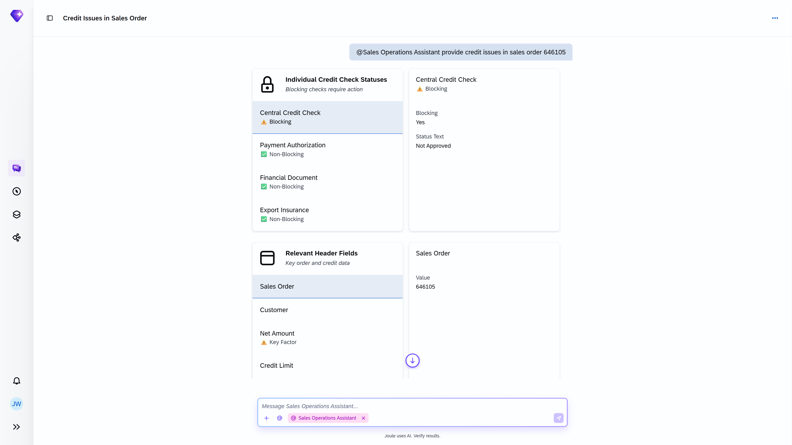
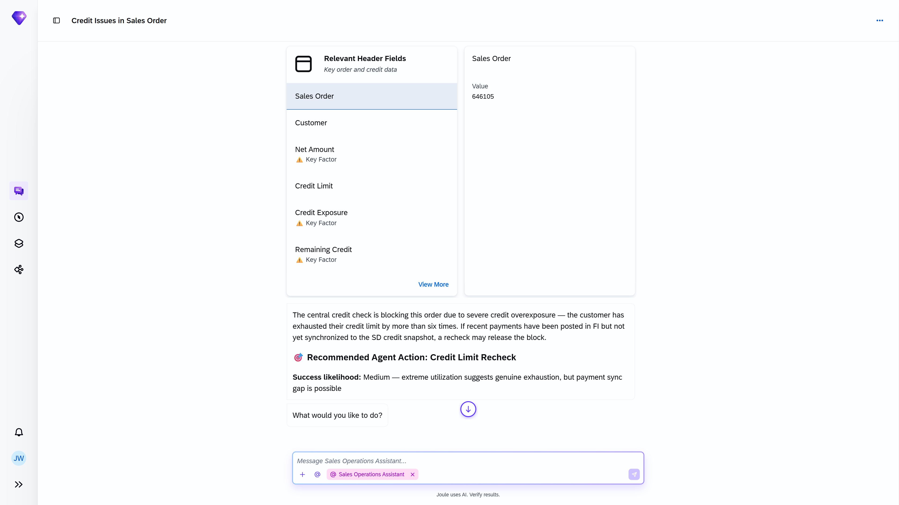
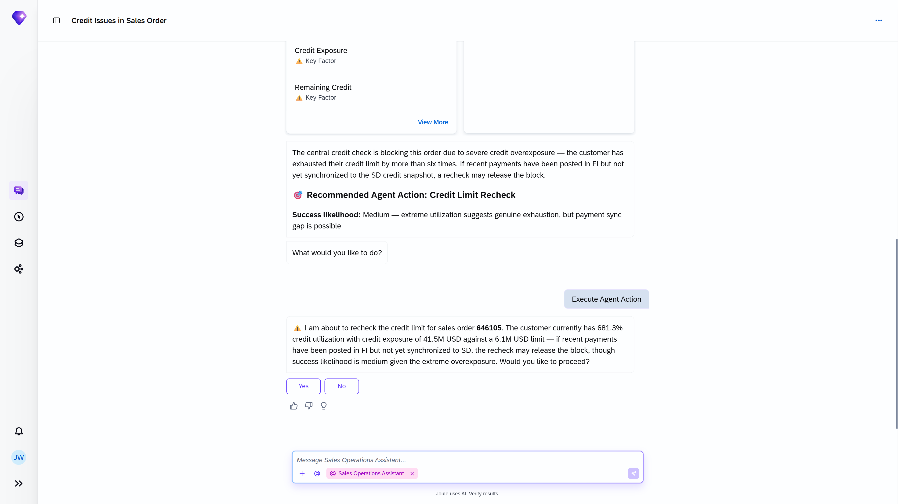

## Credit Block Issues Resolution Agent

**Identifier:** J1502 | [Discovery Center](https://discovery-center.cloud.sap/protected/index.html#/ai-agent/b7980c3e-9667-4990-9e68-85de3fbfadfd/) | **Minimum Version:** SAP S/4HANA 2025 FPS01

### Objective

Handles sales orders automatically blocked due to a customer's credit exposure exceeding predefined limits, or because a credit check has failed. The agent surfaces the credit situation and recommends the action needed to release the block or escalate.

### What It Can Do

- Display customer credit utilisation and current credit exposure
- Show credit status details: risk class, credit limit, and open deliveries
- Recommend corrective actions such as adjusting the credit limit or reviewing outstanding deliveries
- Support the decision to release the block or escalate for further review

### Example Prompts

| Prompt |
|--------|
| "Does sales order 50004567 have a credit block?" |
| "What is the credit status of the customer on sales order 50004567?" |
| "Find the reason for the credit block on sales order 50004567 and recommend next steps." |
| "Check the customer credit limit and open deliveries for sales order 50004567." |
| "What sales orders are currently blocked for credit issues?" |

  

*Figure – Credit Block Issues Resolution Agent in action (Source: SAP Discovery Center)*

## Screenshots

