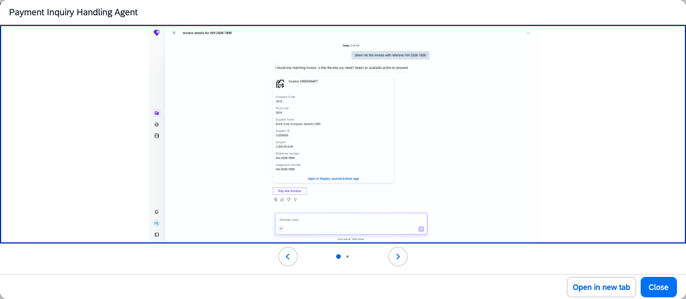
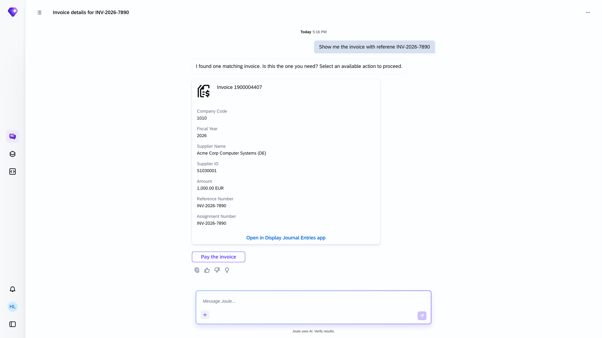
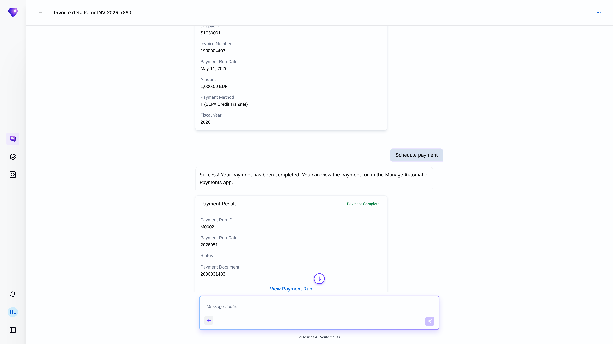

## Payment Inquiry Handling Agent

**Identifier:** J1665 | [Discovery Center](https://discovery-center.cloud.sap/protected/index.html#/ai-agent/66df8316-cf43-4be9-bff2-46b459915125/)

### Objective

Handles payment inquiries, invoice searches, and ad-hoc payment scheduling for supplier invoices through natural language interactions in Joule. The agent enables AP accountants to find invoices, check payment status, and schedule individual ad-hoc payments without navigating multiple transactions.

### What It Can Do

- Search for open supplier invoices by supplier, company code, document number, external reference, or assignment
- Display invoice details including status, amounts, payment terms, and blocking reasons
- Schedule ad-hoc payments for individual supplier invoices with user confirmation
- Extract invoice data from uploaded PDF documents and initiate payment
- Block payments for invoices with payment blocks and explain the reason to the user
- Present a confirmation step before executing any payment action (human-in-the-loop)

### Example Prompts

| Prompt |
|--------|
| "Find open invoices for supplier [supplier ID] in company code [code]." |
| "Show me the invoice with document number [number] in company code [code]." |
| "Show me invoices with external reference [reference]." |
| "Pay my bills for supplier [supplier ID] in company code [code]." |
| "I have an urgent payment request." |

> **Note:** The Payment Inquiry Handling Agent does not support mass or bulk payments. All payments require explicit user confirmation before execution. Feature flag `FAP_ADHOC_PAYMENT_AGENT` and scope item **J60** must be active.

## Screenshots

