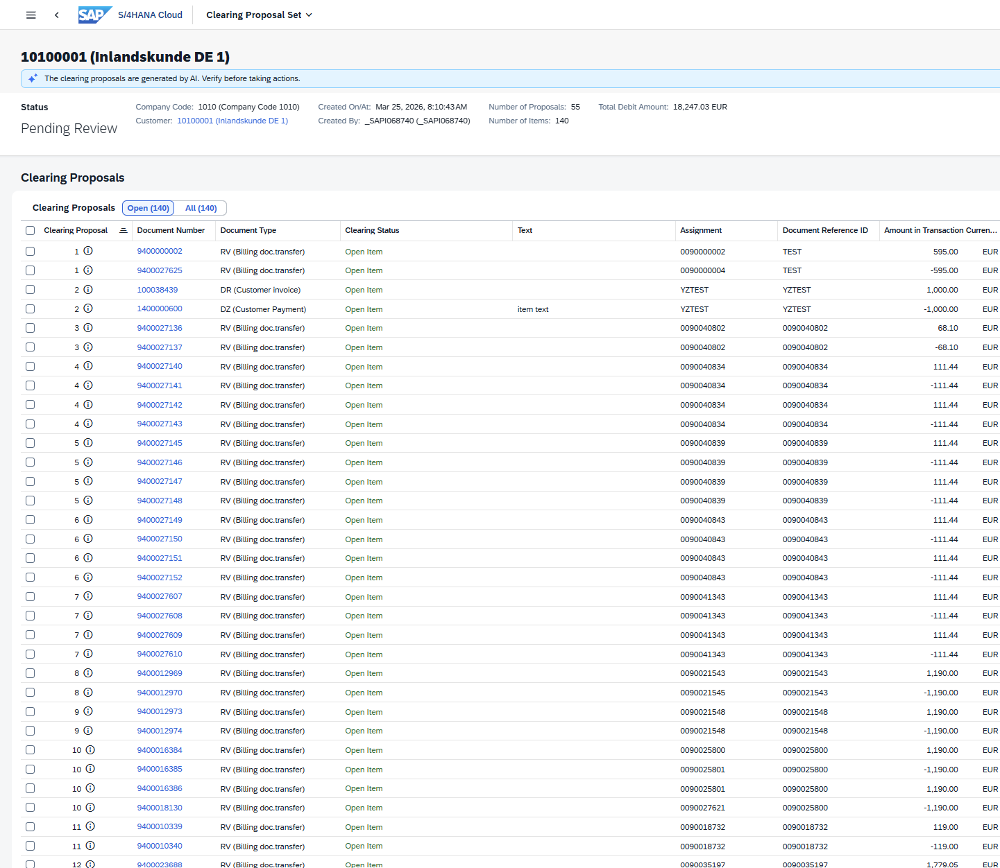
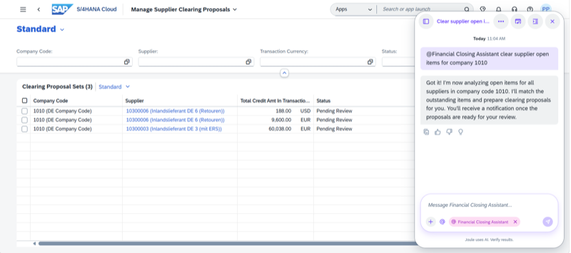
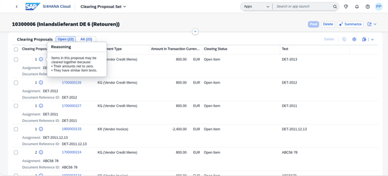

## Receivables and Payables Clearing Agent

**Identifier:** J1275 | [Discovery Center](https://discovery-center.cloud.sap/protected/index.html#/ai-agent/507e1504-f472-4a7c-bb0a-38219f278496/)

### Objective

Automatically generates clearing proposals for open receivable and payable items, streamlining the clearing process and reducing the time spent on reconciliation tasks during period-end close.

### What It Can Do

- Generate clearing proposals for open supplier payable items
- Generate clearing proposals for open customer receivable items
- Present proposals in the **Manage Supplier Clearing Proposals** and **Manage Customer Clearing Proposals** apps for review and approval

### Example Prompts

| Prompt |
|--------|
| "Generate clearing proposals for open payables in company code 1000." |
| "Create supplier clearing proposals for company code 1000." |
| "Show me open payable items for supplier [supplier ID] in company code 1000." |
| "Help me clear open items for supplier [supplier ID] in company code 1000." |

> **Note:** All clearing proposals require user review and approval before posting. No items are cleared automatically.

## Screenshots

