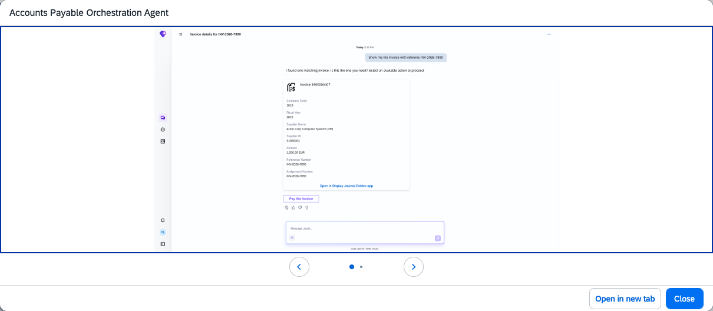
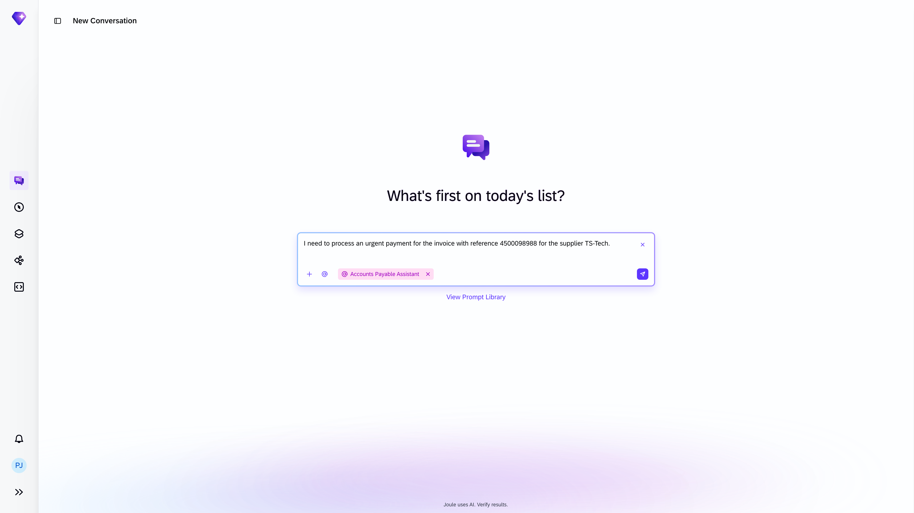
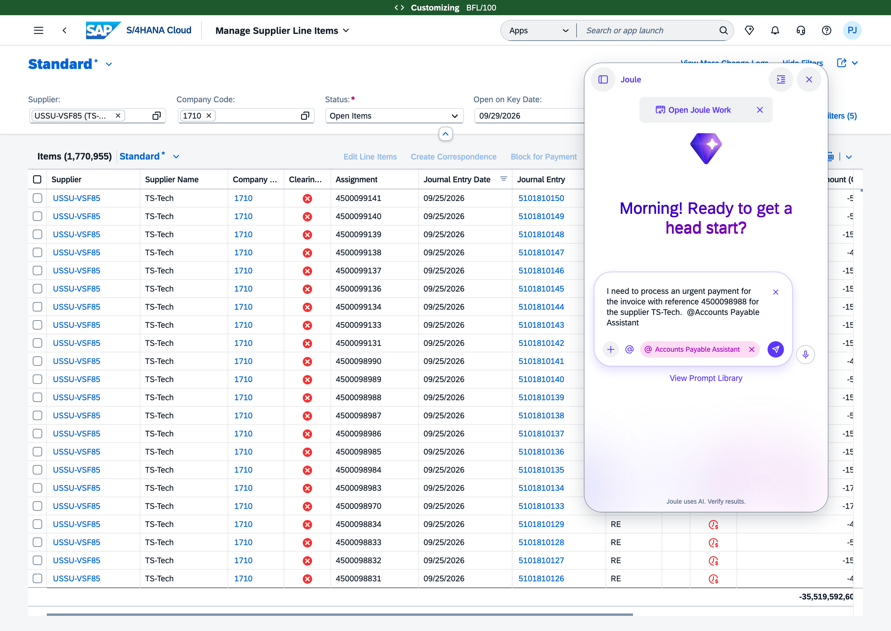

## Accounts Payable Orchestration Agent

**Identifier:** J2220 | [Discovery Center](https://discovery-center.cloud.sap/protected/index.html#/ai-agent/dc6902b1-d48a-4eba-90f7-276af710fede/)

### Objective

Coordinates the specialised agents within the Accounts Payable Assistant. The orchestration agent receives user requests through Joule, determines which sub-agent is best suited to handle each task, and dispatches accordingly — covering payment inquiries and open item clearing.

### What It Can Do

- Interpret natural language requests and route them to the appropriate AP sub-agent
- Coordinate multi-step AP tasks that span invoice inquiries and clearing activities
- Provide a single entry point for all Accounts Payable Assistant interactions in Joule

### Sub-agents Coordinated

| Sub-agent | Responsibility |
|-----------|---------------|
| Payment Inquiry Handling Agent | Invoice search, ad-hoc payment scheduling, payment status |
| Receivables and Payables Clearing Agent | Clearing proposals for open supplier payable items |

### Works With

- SAP S/4HANA Cloud Public Edition

### Example Prompts

| Prompt |
|--------|
| "Help me with accounts payable." |
| "Show me invoices for supplier [supplier ID] in company code [code]." |
| "Clear supplier open items for company code [code]." |
| "What can the Accounts Payable Assistant help me with?" |

> **Note:** The orchestration agent does not perform tasks directly. All AP actions are executed by the sub-agents it coordinates.

## Screenshots

