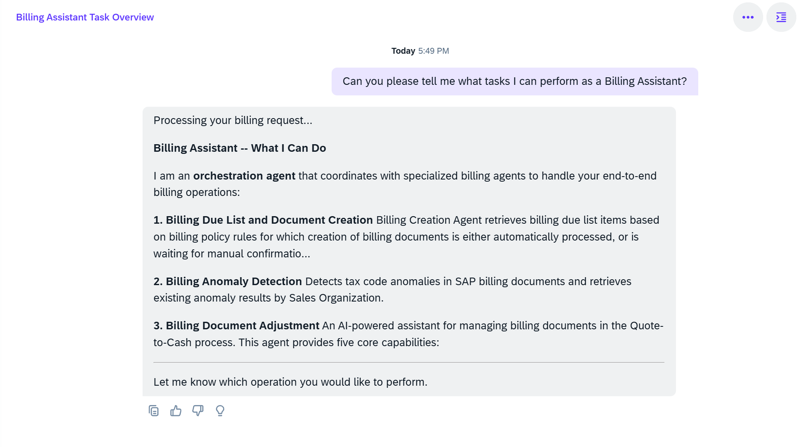

## Billing Orchestration Agent

**Identifier:** J2198 | [Discovery Center](https://discovery-center.cloud.sap/protected/index.html#/ai-agent/8112c6d0-9b69-4c2f-88f8-34ff4c0b3e08/)

### Objective

Coordinates the specialised agents within the Billing Assistant. The orchestration agent receives user requests through Joule, determines which sub-agent is best suited to handle each task, and dispatches accordingly — covering billing creation, adjustment, anomaly detection, posting error resolution, and price verification.

### What It Can Do

- Interpret natural language requests and route them to the appropriate Billing sub-agent
- Coordinate multi-step billing tasks across the full billing lifecycle
- Provide a single entry point for all Billing Assistant interactions in Joule

### Sub-agents Coordinated

| Sub-agent | Responsibility |
|-----------|---------------|
| Billing Creation Agent | Prioritize billing due list to speed up invoice creation |
| Billing Adjustment Agent | Automate adjustment of billing documents |
| Billing Anomaly Agent | Detect unusual taxes and abnormal charges |
| Billing Posting Agent | Automate posting-error resolution |
| Error Explanation and Resolution Agent | Detect errors, explain causes, support informed decisions |
| Project Billing Price Verification Agent | Identify and resolve price discrepancies for project billing |

### Prerequisites

| Requirement | Details |
|-------------|---------|
| System | SAP S/4HANA Cloud Public Edition |
| Scope item | **BD9** (Sell from Stock) |
| IAM app | `F9202_TRAN` (Joule Plugin) — assign to business role via **Maintain Business Roles** |
| Feature flag | `BillingAssistant` (`SDBIL_BILLING_ASSISTANT`) — activate via incident on **SD-BIL-AIA** |

> The orchestration agent requires all sub-agent IAM apps to be assigned as well. See [Post-Provisioning Validations](3.2_Post-Provisioning_Validations.md) for the full IAM app list.

### Works With

- SAP S/4HANA Cloud Public Edition

### Example Prompts

| Prompt |
|--------|
| "Help me with billing." |
| "Show me billing errors for company code [code]." |
| "What can the Billing Assistant help me with?" |

> **Note:** The orchestration agent does not perform tasks directly. All billing actions are executed by the sub-agents it coordinates.

## Screenshots

