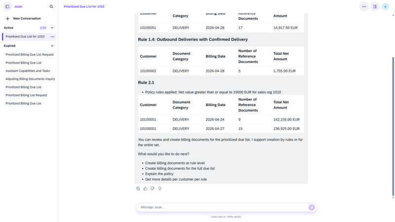

## Billing Creation Agent

**Identifier:** J1291 | [Discovery Center](https://discovery-center.cloud.sap/protected/index.html#/ai-agent/8979984d-5895-4c79-a66c-d84423f72b06/)

### Objective

Helps billing clerks prioritize the billing due list to speed up invoice creation. The agent analyses pending billing items, applies prioritization logic, and guides users through the billing run to ensure the most time-sensitive documents are processed first.

### What It Can Do

- Retrieve and display the billing due list for a company code
- Prioritize billing items based on configurable criteria
- Support guided billing run execution through Joule
- Reduce manual effort in managing the billing backlog

### Prerequisites

| Requirement | Details |
|-------------|---------|
| System | SAP S/4HANA Cloud Public Edition |
| Scope item | **BD9** (Sell from Stock) |
| IAM apps | `F9466_TRAN`, `F8827_TRAN`, `F0798_TRAN`, `F9202_TRAN` — assign to business role via **Maintain Business Roles** |
| Feature flag | `BillingAssistant` (`SDBIL_BILLING_ASSISTANT`) — activate via incident on **SD-BIL-AIA** |
| Billing policy document | Required per sales organization — upload to Joule before first use |

> SAP provides a billing policy document template. Download it from the SAP Help Portal and adapt it to your business requirements before uploading.

### Works With

- SAP S/4HANA Cloud Public Edition

### Example Prompts

| Prompt |
|--------|
| "Show me the billing due list for company code [code]." |
| "Prioritize billing items for company code [code]." |
| "Which billing documents are overdue for company code [code]?" |

## Screenshots

