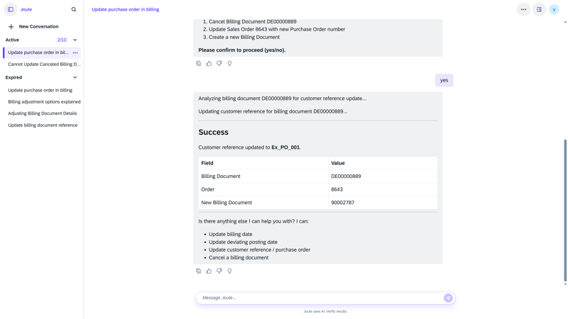

## Billing Adjustment Agent

**Identifier:** J1293 | [Discovery Center](https://discovery-center.cloud.sap/protected/index.html#/ai-agent/03302b4e-4266-42fe-a485-fbc7a2cac9f2/)

### Objective

Helps billing clerks automate the adjustment of billing documents. The agent identifies billing documents that require corrections, supports the adjustment workflow, and ensures that changes are applied accurately — reducing manual rework and processing time.

### What It Can Do

- Change the billing date and deviating posting date in billing documents
- Change the customer reference in billing documents by updating the reference sales order
- Cancel billing documents

### Prerequisites

| Requirement | Details |
|-------------|---------|
| System | SAP S/4HANA Cloud Public Edition |
| Scope item | **BD9** (Sell from Stock) |
| IAM apps | `F9467_TRAN`, `F0797A_TRAN`, `F3893_TRAN`, `F9202_TRAN` — assign to business role via **Maintain Business Roles** |
| Feature flag | `BillingAssistant` (`SDBIL_BILLING_ASSISTANT`) — activate via incident on **SD-BIL-AIA** |

### Example Prompts

| Prompt |
|--------|
| `Cancel billing document 90000001.` |
| `Update the billing date in invoice 90000123 to 2027-01-31.` |
| `Change the customer reference to PO-123456 in document 90000505.` |

> **Note:** Before updating or canceling a billing document, the agent always asks for your confirmation.

## Screenshots

