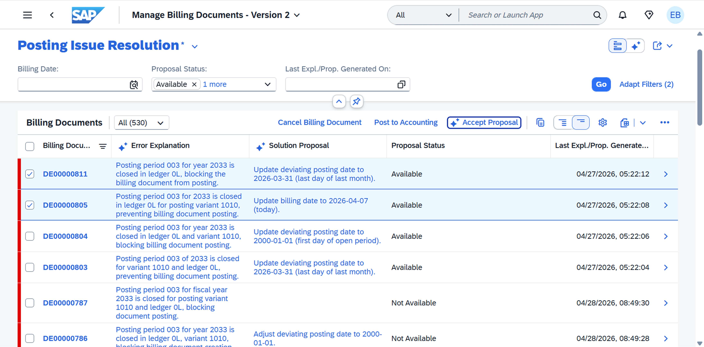

## Billing Posting Agent

**Identifier:** J1294 | [Discovery Center](https://discovery-center.cloud.sap/protected/index.html#/ai-agent/88b8f072-6aea-49a9-a2d5-840430ec232a/)

### Objective

Automates posting-error resolution to keep billing and cash flow on track. The agent identifies billing documents that failed to post, analyses the root cause of each error, and guides billing clerks through corrective actions to ensure timely revenue recognition.

### What It Can Do

- Identify billing documents with posting errors
- Analyse and explain the root cause of posting failures
- Support guided resolution workflows for common posting errors
- Help ensure billing documents are posted accurately and on time

### Prerequisites

| Requirement | Details |
|-------------|---------|
| System | SAP S/4HANA Cloud Public Edition |
| Scope item | **BD9** (Sell from Stock) |
| IAM apps | `F9468_TRAN`, `F8827_TRAN`, `F0797A_TRAN`, `F9202_TRAN` — assign to business role via **Maintain Business Roles** |
| Feature flag | `BillingAssistant` (`SDBIL_BILLING_ASSISTANT`) — activate via incident on **SD-BIL-AIA** |
| CIS access | The Error Explanation and Resolution Agent must be accessible via CIS (required for error analysis sub-calls) |
| Billing policy document | Required per sales organization — upload to Joule before first use |

> SAP provides a billing policy document template. Download it from the SAP Help Portal and adapt it to your business requirements before uploading.
>
> Findings are displayed in the **Manage Billing Documents - Version 2** app under the **Posting Issue Resolution** view. Only results from the latest agent run are visible in Joule; access all findings via the app.

### Works With

- SAP S/4HANA Cloud Public Edition

### Example Prompts

| Prompt |
|--------|
| "Show me billing documents with posting errors for company code [code]." |
| "Why did billing document [document ID] fail to post?" |
| "Help me resolve posting errors for company code [code]." |

> **Note:** Full capabilities and example prompts will be updated here once additional documentation becomes available.

## Screenshots

