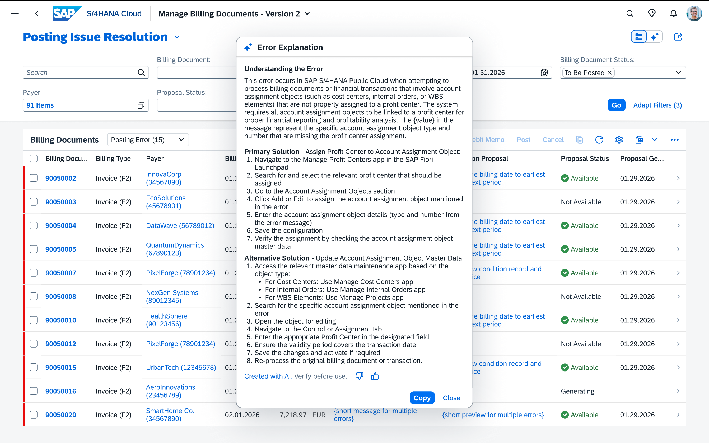

## Error Explanation and Resolution Agent

**Identifier:** J1838 | [Discovery Center](https://discovery-center.cloud.sap/protected/index.html#/ai-agent/40944fa8-80b7-421e-a376-92cc4969a39c/)

> **Important:** This agent cannot be invoked directly by users. It is called internally by the **Billing Posting Agent** to analyze and explain posting errors. Ensure CIS access to this agent is configured so the Billing Posting Agent can reach it.

### Objective

Streamlines error-handling processes and minimises workflow disruptions. Takes technical SAP error messages as input, translates them into clear natural-language explanations, analyses the specific business context, and provides step-by-step resolution steps — reducing reliance on IT support.

### What It Can Do

- Take a technical/functional error code or message as input and translate it into plain-language explanation
- Analyse the specific business context to provide directly relevant resolution steps
- Return a root cause explanation, a primary recommended solution, and one or more alternative solutions
- Attach a confidence score to each response

### Prerequisites

| Requirement | Details |
|-------------|---------|
| System | SAP S/4HANA Cloud Public Edition |
| Access | Must be accessible via CIS for the Billing Posting Agent to call it |

### Constraints

- The agent only supports US English. It can understand multiple languages via the LLM, but SAP strongly recommends interacting in English for best results.

### Works With

- SAP S/4HANA Cloud Public Edition

## Screenshots

