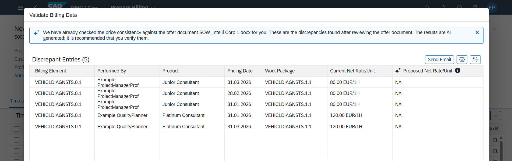

## Project Billing Price Verification Agent

**Identifier:** J1325 | [Discovery Center](https://discovery-center.cloud.sap/protected/index.html#/ai-agent/540eb523-953a-43eb-8f93-525ee99d57fd/)

### Objective

Helps billing specialists identify and resolve price discrepancies in project billing efficiently. The agent analyses project billing documents, compares billed prices against contracted rates and pricing agreements, and surfaces discrepancies for review and correction.

### What It Can Do

- Identify price discrepancies in project billing documents
- Compare billed amounts against contracted rates and pricing agreements
- Surface discrepancies with explanations to support resolution
- Reduce revenue leakage and billing disputes in project-based billing

### Example Prompts

| Prompt |
|--------|
| "Check for price discrepancies in project billing for project [project ID]." |
| "Show me billing documents with price mismatches for company code [code]." |
| "Verify prices on billing document [document ID]." |

> **Note:** Full capabilities and example prompts will be updated here once additional documentation becomes available.

## Screenshots

