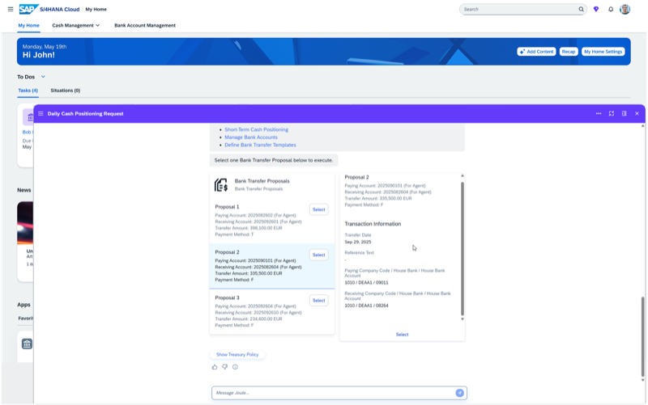

## Cash Positioning Agent

**Identifier:** J585 | [Discovery Center](https://discovery-center.cloud.sap/protected/index.html#/ai-agent/cd99c7b2-f716-46ab-8fe5-640f9aa02613/)

### Objective

Provides visibility into cash positions across bank accounts and supports daily liquidity management activities. The agent helps treasury teams monitor inflows and outflows, review current bank balances, and take informed cash management decisions directly through Joule.

### What It Can Do

- Retrieve current cash position across bank accounts and company codes
- Display daily cash inflows and outflows
- Support liquidity planning by providing an overview of expected receipts and payments
- Help identify cash surpluses or shortfalls across accounts

### Example Prompts

| Prompt |
|--------|
| "Show me the cash position for company code 1000." |
| "What is the current balance for bank account [account ID]?" |
| "Show me today's cash inflows and outflows for company code 1000." |
| "What is the expected cash position for the next 7 days?" |

> **Note:** Full capabilities and example prompts will be updated here once the Cash and Treasury Assistant becomes generally available.

## Screenshots

