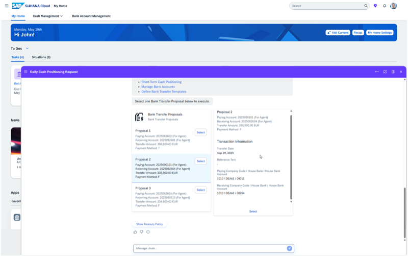

## Cash Positioning Agent

**Identifier:** J585 | [Discovery Center](https://discovery-center.cloud.sap/protected/index.html#/ai-agent/cd99c7b2-f716-46ab-8fe5-640f9aa02613/)

### Objective

Provides visibility into cash positions across bank accounts and supports daily liquidity management activities. The agent helps treasury teams monitor inflows and outflows, review current bank balances, and take informed cash management decisions directly through Joule.

### What It Can Do

- Retrieve current cash position across bank accounts and company codes
- Display daily cash inflows and outflows
- Support liquidity planning by providing an overview of expected receipts and payments
- Help identify cash surpluses or shortfalls across accounts
- Propose bank transfers to resolve cash shortfalls using bank transfer templates

### Prerequisites

In your SAP S/4HANA Cloud Public Edition system:

- Scope item **J78** (Advanced Cash Operations) is activated.
- Business catalog **SAP_FIN_BC_CM_CASH_OPS_PC** (Cash Management - Cash Operations) and the following IAM apps are assigned to your user:
  - **F0691_TRAN** (Make Bank Transfers)
  - **F3759_TRAN** (Define Bank Transfer Templates)
  - **F5380_TRAN** (Short-Term Cash Positioning)
  - **F8829_TRAN** (Short-Term Cash Positioning via API)
- Restriction type **F_TRSY_PLY** (Treasury Policy Type) is granted for treasury policies:
  - `01` — Global policy
  - `02` — User-specific policy
- In the configuration activity **Define Basic Settings** (500156), **Full Scope** is set for the **Cash Scope** setting.

### Data Sources

The agent retrieves data from the following components:

- Cash and Liquidity Management (FIN-FSCM-CLM)
- Treasury and Risk Management (FIN-FSCM-TRM)
- Bank Statements (FI-BL-PT-BA)

### Example Prompts

| Prompt |
|--------|
| "Show me the cash position for company code 1000." |
| "What is the current balance for bank account [account ID]?" |
| "Show me today's cash inflows and outflows for company code 1000." |
| "What is the expected cash position for the next 7 days?" |

## Screenshots

