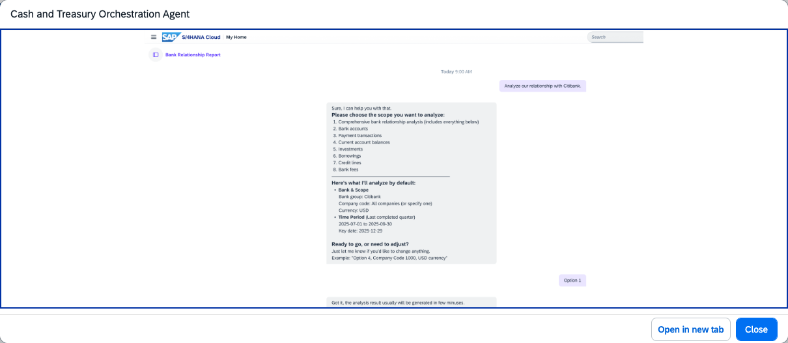

## Bank Relationship Agent

### Objective

Manages bank account master data and supports bank relationship activities through natural language interactions in Joule. The agent helps treasury teams retrieve bank account information, review bank master data, and support ongoing bank relationship management without navigating multiple transactions.

### What It Can Do

- Retrieve bank account master data and account details
- Display bank account status and related attributes
- Support bank relationship management activities
- Help identify and review bank account information across company codes

### Example Prompts

| Prompt |
|--------|
| "Show me the bank accounts for company code 1000." |
| "What is the status of bank account [account ID]?" |
| "Display bank master data for bank [bank key]." |
| "List all active bank accounts for company code 1000." |

> **Note:** Full capabilities and example prompts will be updated here once the Cash and Treasury Assistant becomes generally available.

