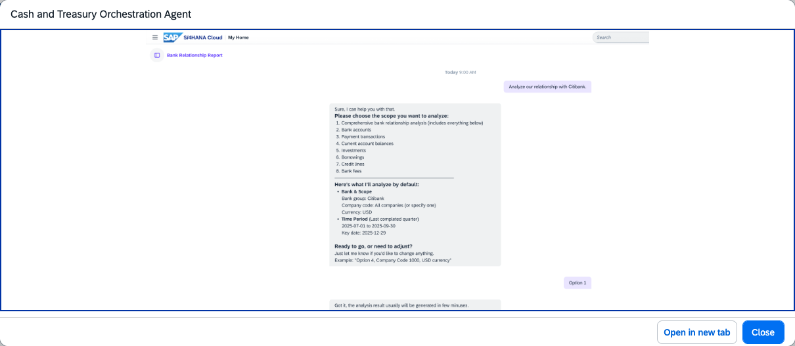

## Cash and Treasury Orchestration Agent

**Identifier:** J2219 | **Minimum Version:** SAP S/4HANA 2023 FPS01 | [Discovery Center](https://discovery-center.cloud.sap/protected/index.html#/ai-agent/9416d24a-688a-4b4c-b44b-5de2e6990f4b/)

### Objective

Coordinates the specialised agents within the Cash and Treasury Assistant. The orchestration agent receives user requests through Joule, determines which sub-agent is best suited to handle each task, and dispatches accordingly — covering cash positioning and bank relationship activities.

### What It Can Do

- Interpret natural language requests and route them to the appropriate Cash and Treasury sub-agent
- Coordinate multi-step treasury tasks that span cash positioning and bank relationship activities
- Provide a single entry point for all Cash and Treasury Assistant interactions in Joule

### Sub-agents Coordinated

| Sub-agent | Responsibility |
|-----------|---------------|
| Cash Positioning Agent | Cash positions across bank accounts, daily liquidity management |
| Bank Relationship Agent | Bank account master data and bank relationship activities |

### Works With

- SAP S/4HANA Cloud Public Edition
- SAP S/4HANA Cloud Private Edition

### Example Prompts

| Prompt |
|--------|
| "Help me with cash management." |
| "I need to review our bank accounts and current cash positions." |
| "What can the Cash and Treasury Assistant help me with?" |

> **Note:** The orchestration agent does not perform tasks directly. All treasury actions are executed by the sub-agents it coordinates.

