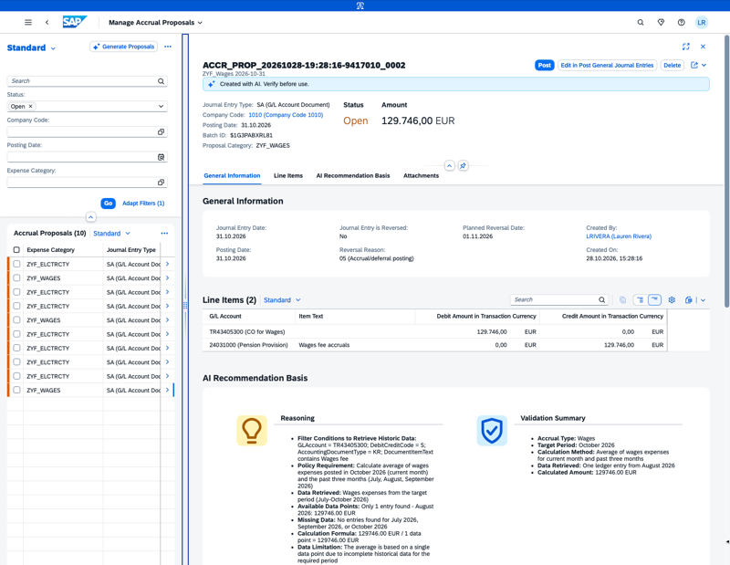

## Accounting Accruals Agent

**Identifier:** J787 | [Discovery Center](https://discovery-center.cloud.sap/protected/index.html#/ai-agent/2ba6ab3e-ff22-4cb6-b3b4-20613ae8f6e3/)

### Objective

Automates the preparation of manual accruals during month-end financial closing. The agent reads and interprets the company accounting policy from an uploaded handbook, identifies relevant accrual types, retrieves historical financial data, applies calculation rules, and generates accrual proposals for review. This improves accuracy and efficiency in the financial close process.

### What It Can Do

- Upload and process a company accounting policy handbook (PDF) containing expense categories and accrual calculation rules
- Generate accrual proposals based on the uploaded policy, identifying outstanding accruals not yet posted to the ledger
- Create accounting documents for accruals in the specified period and company code
- Present proposals in the **Manage Accrual Proposals** app for review and posting
- Post accrual journal entries directly from the proposals app

### Example Prompts

| Prompt |
|--------|
| "I want to upload an accruals policy handbook." |
| "Help me upload an accruals policy handbook." |
| "Propose accounting documents for accruals that have not yet been posted to the ledger for the month of [month] [year] for company code [xxx]." |
| "Create proposals and accounting documents for accruals in the month of [month] [year] for company code [xxx]." |

> **Note:** The policy handbook must be in PDF format and must not exceed five expense categories to prevent timeout issues. Do not upload a second handbook while one is being processed.

## Screenshots

