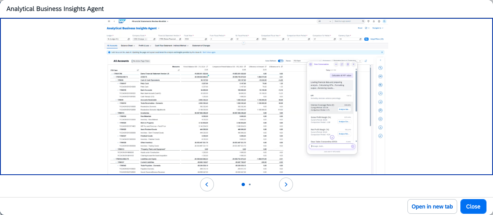

## Analytical Business Insights Agent

**Identifier:** J1476 | [Discovery Center](https://discovery-center.cloud.sap/protected/index.html#/ai-agent/d3163593-6a89-4258-8658-975f95dc9256/)

### Objective

Evaluates company-level financial status from a KPI perspective and generates summary analyses for management review. The agent helps finance teams identify abnormal KPI values, drill down into contributing factors, and share findings with relevant stakeholders.

### What It Can Do

- Calculate financial KPIs across four categories: Profitability, Leverage, Liquidity, and Efficiency
- Analyze a specific KPI to get a detailed explanation of the variance
- Perform Smart Drill Down — a dimensional analysis that expands financial statement line items by adding detailed breakdowns
- Summarize variance drivers using Contribution Attribution, separating total variance into contributions from each dimension or dimension combination
- Generate summary reports for management review

### KPIs Supported

| Type | KPIs |
|------|------|
| Profitability | Gross Profit Margin, Net Profit Margin |
| Leverage | Liabilities-to-Asset Ratio, Liabilities-to-Equity Ratio, Interest Coverage Ratio |
| Liquidity | Current Ratio, Quick Ratio, Cash Ratio |
| Efficiency | Working Capital / Revenue, Days Sales Outstanding, Days Payable Outstanding, Days Inventory Outstanding |

### Example Prompts

| Prompt |
|--------|
| "Please calculate all financial KPIs." |
| "Analyze the Cash Ratio for company code 1000." |
| "What caused the variance in Gross Profit Margin this period?" |
| "Show me the KPIs sorted by absolute variance percentage." |

> **Note:** The agent only works on the **All Accounts** page in the predefined **Financial Statements Review Booklet** app. Disable the Agentic Thinking option in the Joule dialog to start this agent. For optimal accuracy, keep each Joule conversation focused on a single business scenario.

