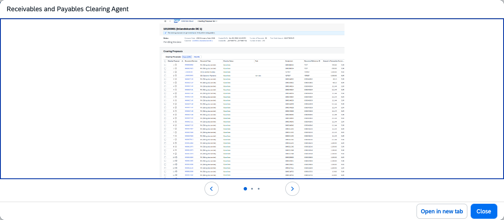

## Receivables and Payables Clearing Agent

**Identifier:** J1275 | [Discovery Center](https://discovery-center.cloud.sap/protected/index.html#/ai-agent/507e1504-f472-4a7c-bb0a-38219f278496/)

### Objective

Automatically generates clearing proposals for open receivable and payable items, streamlining the clearing process and reducing the time spent on reconciliation tasks. The agent identifies open items and proposes matching entries for both customer (receivable) and supplier (payable) accounts.

### What It Can Do

- Generate clearing proposals for open customer receivable items
- Generate clearing proposals for open supplier payable items
- Present proposals in the **Manage Customer Clearing Proposals** and **Manage Supplier Clearing Proposals** apps for review and approval
- Reduce manual effort in the period-end clearing and reconciliation process

### Example Prompts

| Prompt |
|--------|
| "Generate clearing proposals for open receivables in company code 1000." |
| "Create supplier clearing proposals for company code 1000." |
| "Show me open payable items for supplier [supplier ID] in company code 1000." |
| "Help me clear open items for customer [customer ID] in company code 1000." |

> **Note:** All clearing proposals require user review and approval before posting. No items are cleared automatically.

