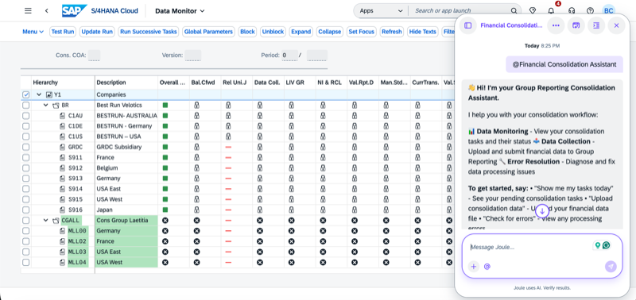

## Financial Consolidation Data Submission Agent

**Identifier:** J1883 | [Discovery Center](https://discovery-center.cloud.sap/protected/index.html#/ai-agent/c39f45a0-a19d-405a-b313-4d419a9c0172/)

### Objective

Helps local accountants automate data submissions to the consolidation system and resolve submission errors. The agent guides users through the data submission process, identifies and explains submission errors, and supports corrective actions to ensure accurate and timely consolidation reporting.

### What It Can Do

- Submit consolidation data for a consolidation unit and period
- Check the status of existing data submissions
- Identify and explain submission errors in plain language
- Guide users through corrective actions to resolve submission issues

### Example Prompts

| Prompt |
|--------|
| "Submit consolidation data for consolidation unit [unit] for period [period]." |
| "What is the submission status for consolidation unit [unit]?" |
| "Show me submission errors for consolidation unit [unit]." |
| "Help me resolve the submission error for consolidation unit [unit]." |

> **Note:** Full capabilities and example prompts will be updated here once additional documentation becomes available.

## Screenshots

