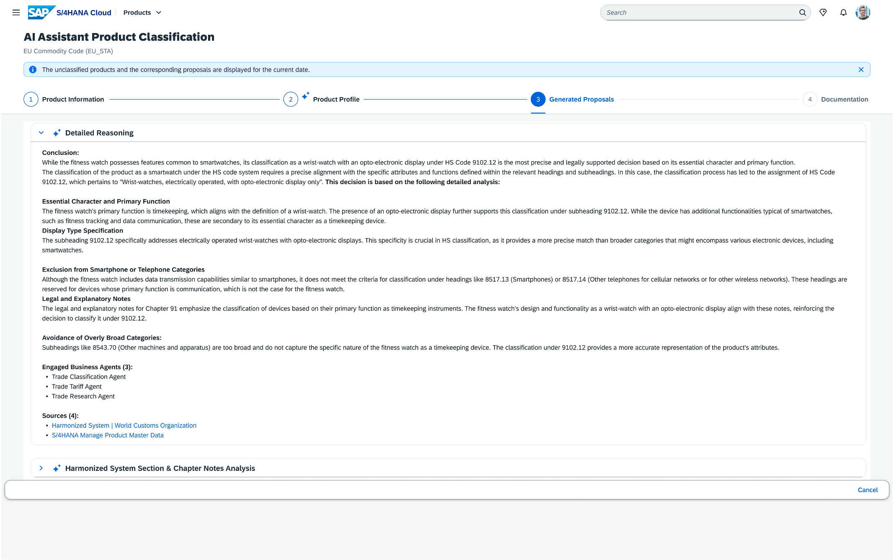

## International Trade Classification Agent

**Identifier:** J648 | [Discovery Center](https://discovery-center.cloud.sap/protected/index.html#/ai-agent/cb3aa823-c475-4f81-9730-d35d85bd55c7/)

### Objective

Saves time and ensures trade compliance by automatically classifying goods for shipping. The agent applies AI to analyse product descriptions and master data, proposes commodity codes and export control classifications, and supports trade compliance specialists in maintaining accurate and up-to-date product classifications.

### What It Can Do

- Automatically classify goods using commodity codes (e.g., HS codes, customs tariff numbers)
- Propose export control classifications based on product descriptions and attributes
- Support review and confirmation of AI-proposed classifications
- Reduce manual classification effort and the risk of misclassification

### Works With

- SAP S/4HANA Cloud Public Edition

### Example Prompts

| Prompt |
|--------|
| "Classify material [material ID] for export." |
| "What is the commodity code for [product description]?" |
| "Show me materials that need classification review." |

> **Note:** Full capabilities and example prompts will be updated here once additional documentation becomes available.

## Screenshots

